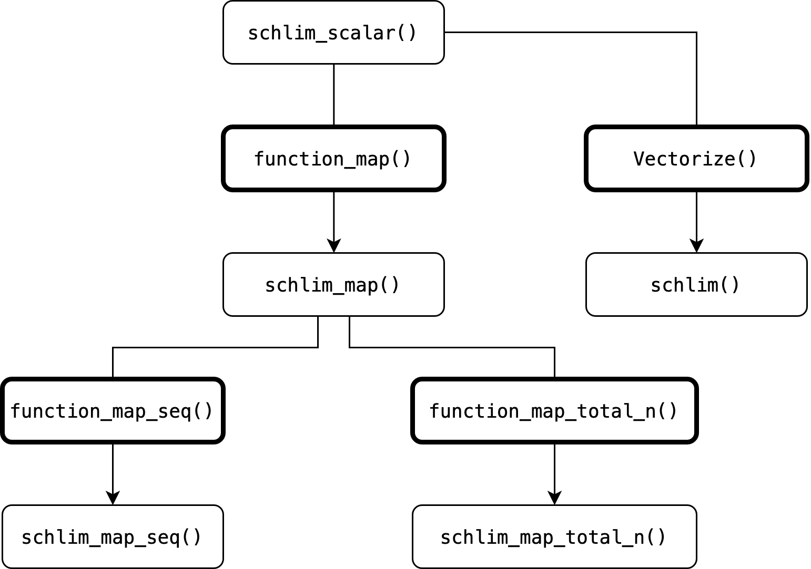

# Consistency tests in depth

## Introduction

This vignette describes scrutiny’s infrastructure for implementing new
consistency tests.

A consistency test is implemented at several levels, most of them
created from the previous one by a function factory. Since the factories
work the same way for every test, all test functions share one
interface: anyone who knows the `grim_*()` functions can use the
`grimmer_*()` functions as well.

These are the levels, with GRIM as the example. If you implement a valid
consistency test at least at the first level, I’ll be happy to accept a
pull request to scrutiny.

1.  A non-exported function that tests a single case, such as
    `grim_scalar()`.

2.  A vectorized version of it, such as
    [`grim()`](https://lhdjung.github.io/scrutiny/reference/grim.md).

3.  A mapper that applies the single-case function to each row of a data
    frame, such as
    [`grim_map()`](https://lhdjung.github.io/scrutiny/reference/grim_map.md).

4.  An
    [`audit()`](https://lhdjung.github.io/scrutiny/reference/audit.md)
    method that summarizes the output of number 3, and an
    [`explain_map()`](https://lhdjung.github.io/scrutiny/reference/explain_map.md)
    method that explains it.

5.  A function that plots the output of number 3, such as
    [`grim_plot_grid()`](https://lhdjung.github.io/scrutiny/reference/grim_plot_grid.md).

6.  A sequence mapper that tests slightly varied input values, such as
    [`grim_map_seq()`](https://lhdjung.github.io/scrutiny/reference/grim_map_seq.md).

7.  A total-n mapper for studies with two groups that only report the
    total sample size, such as
    [`grim_map_total_n()`](https://lhdjung.github.io/scrutiny/reference/grim_map_total_n.md).

The examples use a mock test called SCHLIM, which has no meaning in
itself. A real implementation will usually be more complex than the
snippets below.

Please follow the [tidyverse style guide](https://style.tidyverse.org/)
and the conventions below. To write a new package, see [*R
Packages*](https://r-pkgs.org/) (Wickham and Bryan 2023).

## 1. Single-case

This function contains the test itself. It is not exported, but every
other level builds on it.

It takes one value for each statistic that is tested for consistency
with the others. It returns `TRUE` if they are consistent, `FALSE` if
they aren’t, and `NA` if the case can’t be decided, as with a missing
value. In scrutiny’s own tests, a missing value only makes the result
`NA` if some value in its place would make the case consistent and
another would not; see *Missing values* in
[`vignette("technical-notes")`](https://lhdjung.github.io/scrutiny/articles/technical-notes.md).

``` r

schlim_scalar <- function(y, n) {
  (y / 3) > n
}

schlim_scalar(y = 30, n = 4)
#> [1] TRUE
schlim_scalar(y = 2, n = 7)
#> [1] FALSE
```

If the test reconstructs rounded numbers, give the function a `rounding`
argument with the default `"up_or_down"`, and pass it on to
[`roundwork::reround()`](https://lhdjung.github.io/roundwork/reference/reround.html)
or
[`roundwork::unround()`](https://lhdjung.github.io/roundwork/reference/unround.html);
see
[`vignette("rounding-in-depth", package = "roundwork")`](https://lhdjung.github.io/roundwork/articles/rounding-in-depth.html).
To compare the range of a rounded value with whole numbers, as GRIM
does, use
[`roundwork::bound_numerators()`](https://lhdjung.github.io/roundwork/reference/bound_numerators.html)
or
[`roundwork::sum_range()`](https://lhdjung.github.io/roundwork/reference/sum_range.html),
which keep the comparison exact; see *Exact arithmetic* in
[`vignette("technical-notes")`](https://lhdjung.github.io/scrutiny/articles/technical-notes.md).
Take the number of decimal places as an argument without a default, like
`digits_x` in
[`grim()`](https://lhdjung.github.io/scrutiny/reference/grim.md), rather
than counting them: a numeric value has lost any trailing zeros.

[`decimal_places()`](https://lhdjung.github.io/scrutiny/reference/decimal_places.md)
counts the digits after the decimal point or another separator. It takes
numbers and strings, and it is vectorized:

``` r

decimal_places("2.80")
#> [1] 2

decimal_places(c(55.1, 6.493, 8))
#> [1] 1 3 0
```

Numeric values drop trailing zeros, whereas strings preserve them. This
is why the consistency tests take the number of decimal places as an
argument rather than counting it:

``` r

decimal_places(7.200)
#> [1] 1

decimal_places("7.200")
#> [1] 3
```

Name the function after the test in lowercase, followed by `_scalar`. If
R’s own vectorization already makes it work on vectors in every
argument, leave out `_scalar`, export it, and skip section 2.

Exported scrutiny functions often call internal helpers, most of which
are documented in
[utils.R](https://github.com/lhdjung/scrutiny/blob/main/R/utils.R). To
reuse one, copy its source code, which `scrutiny:::helper_name` (without
parentheses) prints. Don’t call it with `:::` in your code: internals
can change or vanish without notice. See [this
blogpost](https://tidyverse.org/blog/2022/09/playing-on-the-same-team-as-your-dependecy/)
by Thomas Lin Pedersen.

## 2. Vectorized

The simplest way to vectorize the single-case function is
[`Vectorize()`](https://rdrr.io/r/base/Vectorize.html). The result is
named after the test:

``` r

schlim <- Vectorize(schlim_scalar)

schlim(y = 10:15, n = 4)
#> [1] FALSE FALSE FALSE  TRUE  TRUE  TRUE
```

[`Vectorize()`](https://rdrr.io/r/base/Vectorize.html) loops over every
argument. This is wrong for two kinds of arguments: those that only the
mapper should set, such as `show_rec` in `grim_scalar()`, which makes
the function return a list; and those that describe the test as a whole,
such as `rounding`. This is why
[`grim()`](https://lhdjung.github.io/scrutiny/reference/grim.md),
[`grimmer()`](https://lhdjung.github.io/scrutiny/reference/grimmer.md),
and [`debit()`](https://lhdjung.github.io/scrutiny/reference/debit.md)
have handwritten signatures instead. If your single-case function has
such arguments, do the same: loop over the reported values only, and
pass the other arguments on as they are. Suppose `schlim_scalar()` took
a `rounding` argument:

``` r

schlim <- function(y, n, rounding = "up_or_down") {
  purrr::map2_lgl(y, n, schlim_scalar, rounding = rounding)
}
```

[`purrr::map2_lgl()`](https://purrr.tidyverse.org/reference/map2.html)
recycles only values of length 1, so `y` and `n` must otherwise have the
same length. Use
[`purrr::pmap_lgl()`](https://purrr.tidyverse.org/reference/pmap.html)
for three or more reported values.

The rest of the vignette builds on the mapper, not on the vectorized
function.

## 3. Basic mapper

### Creating basic mappers with `function_map()`

A mapper applies the test to every row of a data frame, as
[`grim_map()`](https://lhdjung.github.io/scrutiny/reference/grim_map.md)
does. Every function in the rest of the vignette builds on it. It
accepts any data frame and returns a
[tibble](https://tibble.tidyverse.org/).

Create mappers with
[`function_map()`](https://lhdjung.github.io/scrutiny/reference/function_map.md):

``` r

schlim_map <- function_map(
  .fn = schlim_scalar,
  .reported = c("y", "n"),
  .name_test = "SCHLIM"
)

# Example data:
df1 <- tibble::tibble(y = 16:25, n = 3:12)

schlim_map(df1)
#> # A tibble: 10 × 3
#>        y     n consistency
#>    <int> <int> <lgl>      
#>  1    16     3 TRUE       
#>  2    17     4 TRUE       
#>  3    18     5 TRUE       
#>  4    19     6 TRUE       
#>  5    20     7 FALSE      
#>  6    21     8 FALSE      
#>  7    22     9 FALSE      
#>  8    23    10 FALSE      
#>  9    24    11 FALSE      
#> 10    25    12 FALSE
```

These arguments are required:

- `.fn` is the single-case function from section 1.

- `.reported` names the arguments of `.fn` that take the reported
  statistics. These become the key columns.
  [`function_map()`](https://lhdjung.github.io/scrutiny/reference/function_map.md)
  does not assume any particular number of them: GRIM has two, GRIMMER
  and DEBIT have three.

- `.name_test` is the name of the test, used in messages and in the
  class of the output.

Every other argument of `.fn` becomes an argument of the mapper, with
the same default. Optional arguments of
[`function_map()`](https://lhdjung.github.io/scrutiny/reference/function_map.md)
control how some of them are treated:

| Argument | Purpose | Example in scrutiny |
|:---|:---|:---|
| `.args_by_row` | Arguments that take one value per row, returned as columns | `digits_x` |
| `.cols_helper` | Arguments that may also be columns of `data`, returned after the key columns if given | `items_averaged` |
| `.args_fixed` | Values always passed to `.fn`; the mapper has no argument for them | `list(show_reason = TRUE)` in [`grimmer_map()`](https://lhdjung.github.io/scrutiny/reference/grimmer_map.md) |
| `.args_disabled` | Arguments of `.fn` that the mapper should not have |  |
| `.col_names` | Names of the columns that a list returned by `.fn` unpacks into; the first is the key result | `show_rec = TRUE` columns |
| `.cols_derived` | Vectorized functions that compute further columns from the same columns | `list(exp_incon = grim_exp_incon)` |
| `.name_class` | Extra classes for the output |  |
| `.name_key_result` | Name of the result column, `"consistency"` by default |  |

[`grim_map()`](https://lhdjung.github.io/scrutiny/reference/grim_map.md)
itself is made this way:

``` r

grim_map <- function_map(
  .fn = grim_scalar,
  .reported = c("x", "n"),
  .name_test = "GRIM",
  .args_by_row = "digits_x",
  .cols_helper = c("items_averaged", "data_type"),
  .col_names = c(
    "consistency",
    "rec_sum",
    "sum_lower",
    "sum_upper",
    "rec_x_upper",
    "rec_x_lower"
  ),
  # Not returned by `grim_scalar()`, which would change what `grim()` returns:
  .cols_derived = list(exp_incon = grim_exp_incon)
)
```

The output has the key columns first, then any helper columns that were
given, any columns of `.args_by_row` arguments, and `consistency`. Other
columns of `data` follow it. Functions built on the mapper, such as
[`function_map_seq()`](https://lhdjung.github.io/scrutiny/reference/function_map_seq.md),
read the columns left of `consistency` as the input to the test. The
arguments of a call that apply to all rows, such as `rounding`, are
recorded on the output; see
[`scrutiny_meta()`](https://lhdjung.github.io/scrutiny/reference/scrutiny_meta.md).

#### Context and export

[`function_map()`](https://lhdjung.github.io/scrutiny/reference/function_map.md)
takes the place of `function()`: it is a function factory, or more
precisely a [function
operator](https://adv-r.hadley.nz/function-operators.html) (Wickham
2019), like [`Vectorize()`](https://rdrr.io/r/base/Vectorize.html).

To export a function made this way from your own package, follow [this
purrr
FAQ](https://purrr.tidyverse.org/reference/faq-adverbs-export.html),
with scrutiny in the role of purrr:

``` r

schlim_map <- function(...) "dummy"

.onLoad <- function(lib, pkg) {
  schlim_map <<- scrutiny::function_map(
    .fn = schlim_scalar,
    .reported = c("y", "n"),
    .name_test = "SCHLIM"
  )
}
```

#### Identifying columns

Factory-made functions have one argument for each `.reported` value. If
the columns of `data` have other names, specify these names via the
arguments:

``` r

df2 <- df1
names(df2) <- c("foo", "bar")

schlim_map(df2, y = foo, n = bar)
#> # A tibble: 10 × 3
#>        y     n consistency
#>    <int> <int> <lgl>      
#>  1    16     3 TRUE       
#>  2    17     4 TRUE       
#>  3    18     5 TRUE       
#>  4    19     6 TRUE       
#>  5    20     7 FALSE      
#>  6    21     8 FALSE      
#>  7    22     9 FALSE      
#>  8    23    10 FALSE      
#>  9    24    11 FALSE      
#> 10    25    12 FALSE
```

A key column that is neither present in `data` nor identified via an
argument is an error:

``` r

schlim_map(df2, y = foo)
#> Error in `schlim_map()`:
#> ! Column `n` is missing from `data`.
#> ✖ It should be a column of the input data frame.
#> ℹ Alternatively, specify the `n` argument of `schlim_map()` as the name of the
#>   equivalent column.

# With a wrong identification:
schlim_map(df2, n = mike)
#> Error in `schlim_map()`:
#> ! `mike` is not a column name of `data`.
#> ✖ The `n` argument of `schlim_map()` was specified as `mike`, but there is no
#>   column in `data` called `mike`.
```

#### A variable number of key columns

Some tests don’t have a fixed set of key columns. Think of a test that
checks whether the values in any number of columns add up to the value
in another column: how many columns go into each check depends on the
data, not on the test.

Write the `*_scalar()` function so that it takes those values as a
single vector argument, and name that argument in `.reported_variadic`:

``` r

sum_check_scalar <- function(parts, total, tolerance = 0) {
  abs(sum(parts) - total) <= tolerance
}

sum_check_map <- function_map(
  .fn = sum_check_scalar,
  .reported = "total",
  .reported_variadic = "parts",
  .name_test = "SUMCHECK"
)
```

The mapper then has a `parts` argument that selects columns using
[tidyselect](https://tidyselect.r-lib.org/) syntax, alongside the
ordinary `total` key argument:

``` r

df3 <- tibble::tibble(
  item_1 = c(10, 20, 30),
  item_2 = c(5, 5, 5),
  item_3 = c(1, 2, 3),
  total  = c(16, 27, 40)
)

sum_check_map(df3, parts = c(item_1, item_2, item_3))
#> # A tibble: 3 × 5
#>   item_1 item_2 item_3 total consistency
#>    <dbl>  <dbl>  <dbl> <dbl> <lgl>      
#> 1     10      5      1    16 TRUE       
#> 2     20      5      2    27 TRUE       
#> 3     30      5      3    40 FALSE

sum_check_map(df3, parts = starts_with("item"), tolerance = 3)
#> # A tibble: 3 × 5
#>   item_1 item_2 item_3 total consistency
#>    <dbl>  <dbl>  <dbl> <dbl> <lgl>      
#> 1     10      5      1    16 TRUE       
#> 2     20      5      2    27 TRUE       
#> 3     30      5      3    40 TRUE
```

Some points about this mode:

- The selected columns are returned as themselves, so the output is as
  rectangular as any other mapper’s.

- The variadic argument has no default. Selecting all remaining columns
  by default would quietly draw in columns such as identifiers.

- The selection must not be empty or include a key or helper column. So
  `parts = everything()` is an error; write `parts = !total` instead.

- `.reported` may be `NULL` if every key column is variadic.

- Such a mapper cannot be wrapped by
  [`function_map_seq()`](https://lhdjung.github.io/scrutiny/reference/function_map_seq.md)
  or
  [`function_map_total_n()`](https://lhdjung.github.io/scrutiny/reference/function_map_total_n.md),
  which derive their arguments from `.reported`.

[`add_up_to_map()`](https://lhdjung.github.io/scrutiny/reference/add_up_to_map.md)
is made this way; see
[`vignette("percentages-and-sums")`](https://lhdjung.github.io/scrutiny/articles/percentages-and-sums.md).

## 4. `audit()` and `explain_map()` methods

### Basics

[`audit()`](https://lhdjung.github.io/scrutiny/reference/audit.md) is an
S3 generic that summarizes the output of scrutiny’s mappers. Every
mapper should have an
[`audit()`](https://lhdjung.github.io/scrutiny/reference/audit.md)
method, which returns descriptive statistics and nothing else. It
dispatches on the class of the mapper’s output:

``` r

df1_tested <- schlim_map(df1)
class(df1_tested)
#> [1] "scrutiny_schlim_map" "tbl_df"              "tbl"                
#> [4] "data.frame"
```

Like the generic, the method takes `data` and `...`. It returns a tibble
with at least these columns:

1.  `all_cases`, the total number of rows.

2.  `incon_cases`, the number of rows in which `consistency` is `FALSE`.

3.  `emp_incon`, the ratio of `incon_cases` to `all_cases`.

Add any other descriptive statistics that suit the test, such as means
of output columns. All existing methods return a single row. Summaries
by group come from
[`audit()`](https://lhdjung.github.io/scrutiny/reference/audit.md)’s
`.by` argument, which applies the method to each group, so the method
itself needs no grouping.

### Practical steps

The method is a function named `audit` plus a dot and your class. Call
[`audit_cols_minimal()`](https://lhdjung.github.io/scrutiny/reference/audit_cols_minimal.md)
to create a tibble with the three required columns, and add further
columns with
[`dplyr::mutate()`](https://dplyr.tidyverse.org/reference/mutate.html)
or similar:

``` r

audit.scrutiny_schlim_map <- function(data, ...) {
  audit_cols_minimal(data)
}

# This calls our new method:
audit(df1_tested)
#> # A tibble: 1 × 3
#>   all_cases incon_cases emp_incon
#>       <int>       <int>     <dbl>
#> 1        10           6       0.6

# This doesn't work because no method was defined:
audit(iris)
#> Error in `audit()`:
#> ! `audit()` has no method for `data`.
#> ✖ It has class <data.frame>.
#> ℹ See `?audit` for the functions whose output it summarizes.
```

### Documentation

Document each
[`audit()`](https://lhdjung.github.io/scrutiny/reference/audit.md)
method on the page of its mapper, in a section called *Summaries with
[`audit()`](https://lhdjung.github.io/scrutiny/reference/audit.md)* that
lists the columns of its output. See
[`?grim_map`](https://lhdjung.github.io/scrutiny/reference/grim_map.md)
for an example.

### Explanations

[`explain_map()`](https://lhdjung.github.io/scrutiny/reference/explain_map.md)
is a generic, too. Its method adds an `explanation` column, one string
per row, which
[`explain_print()`](https://lhdjung.github.io/scrutiny/reference/explain_print.md)
prints:

``` r

explain_map.scrutiny_schlim_map <- function(data, ...) {
  verdict <- ifelse(data$consistency, "greater", "not greater")
  data$explanation <- paste0(
    data$y, " / 3 = ", round(data$y / 3, 2), ", which is ", verdict,
    " than ", data$n, "."
  )
  data
}

df1_tested |>
  dplyr::slice(4:5) |>
  explain_map() |>
  dplyr::pull(explanation)
#> [1] "19 / 3 = 6.33, which is greater than 6."    
#> [2] "20 / 3 = 6.67, which is not greater than 7."
```

A real explanation should give every number needed to check the result
by hand, as
[`grim_explain()`](https://lhdjung.github.io/scrutiny/reference/grim_explain.md)
does. Sequence and total-n output keeps the class of the basic mapper,
so the method covers it as well.

## 5. Visualization function

How best to plot test results depends on the test: compare
[`grim_plot_grid()`](https://lhdjung.github.io/scrutiny/reference/grim_plot_grid.md)
and
[`debit_plot()`](https://lhdjung.github.io/scrutiny/reference/debit_plot.md).
(Granularity is crucial for GRIM but not for DEBIT.) Still, some
conventions apply:

1.  Plots are based on ggplot2, following its advice on [using ggplot2
    in
    packages](https://ggplot2.tidyverse.org/articles/ggplot2-in-packages.html).
2.  The name is that of the test in lowercase, followed by `_plot`, and
    optionally a description, as in
    [`grim_plot_grid()`](https://lhdjung.github.io/scrutiny/reference/grim_plot_grid.md).
    This doesn’t apply to methods for generics like
    [`ggplot2::autoplot()`](https://ggplot2.tidyverse.org/reference/autoplot.html).
3.  A function that plots mapper output takes it as its first argument,
    `data`, and checks that `data` has the mapper’s class, such as
    `"scrutiny_debit_map"`.
4.  Map the key result column, such as `consistency`, to `colour` and
    `fill`, and add one
    [`ggplot2::scale_colour_manual()`](https://ggplot2.tidyverse.org/reference/scale_manual.html)
    for both with `aesthetics = c("colour", "fill")`. Its values are
    `"#0047ff"` (blue) for consistent value sets and `"#ff2a00"` (red)
    for inconsistent ones, as in scrutiny’s own plots. Users change the
    colors by adding a scale of their own, not through arguments. (Plots
    of a single value set, such as
    [`grim_plot_line()`](https://lhdjung.github.io/scrutiny/reference/grim_plot_line.md),
    have no column to map, so they take the colors as `color_*`
    arguments.)
5.  Optional layers are controlled by logical arguments that start with
    `show_`, such as `show_data` in
    [`grim_plot_grid()`](https://lhdjung.github.io/scrutiny/reference/grim_plot_grid.md)
    or `show_labels` in
    [`debit_plot()`](https://lhdjung.github.io/scrutiny/reference/debit_plot.md).
    Only arguments of this kind start with `show_`, and they have
    defaults.

## 6. Sequence mapper

### Introduction

A consistency test shows that reported values cannot all be correct, but
not why. One common reason is a small error in computing or reporting:
when Brown and Heathers (2017) reanalyzed data sets behind GRIM
inconsistencies, they often found “a straightforward explanation, such
as a minor error in the reported sample sizes, or a failure to report
the exclusion of a participant” (p. 368).

Sequence mappers test for such errors.
[`grim_map_seq()`](https://lhdjung.github.io/scrutiny/reference/grim_map_seq.md),
[`grimmer_map_seq()`](https://lhdjung.github.io/scrutiny/reference/grimmer_map_seq.md),
and
[`debit_map_seq()`](https://lhdjung.github.io/scrutiny/reference/debit_map_seq.md)
vary each reported value by a few steps up and down and test the
resulting value sets, so that consistent values near the reported ones
are found without testing each candidate by hand.

### Practical steps

Create sequence mappers from basic mappers with
[`function_map_seq()`](https://lhdjung.github.io/scrutiny/reference/function_map_seq.md).
This is
[`grimmer_map_seq()`](https://lhdjung.github.io/scrutiny/reference/grimmer_map_seq.md):

``` r

grimmer_map_seq <- function_map_seq(
  .fn = grimmer_map,
  .reported = c("x", "sd", "n"),
  .name_test = "GRIMMER",
  # A standard deviation cannot be negative, but it can be `0`. The mean is
  # unbounded, as it is for GRIM. A sample SD needs two values, a population SD
  # only one:
  .var_bounds = list(
    n = function(args) c(sd_min_n(args$sd_meaning), NA),
    sd = c(0, NA)
  )
)
```

`.var_bounds` sets the least and greatest values to which each variable
may be dispersed, with `NA` for an unbounded side. `n` always has a
minimum of 1. A bound may also be a function of the mapper’s arguments,
as with `n` here. `.var`, `.dispersion`, `.out_min`, `.out_max`,
`.include_reported`, and `.include_consistent` set the defaults of the
corresponding arguments of the new function; see
[`?function_map_seq`](https://lhdjung.github.io/scrutiny/reference/function_map_seq.md).

A sequence mapper can be created in the same way from any other basic
mapper. For SCHLIM:

``` r

schlim_map_seq <- function_map_seq(
  .fn = schlim_map,
  .reported = c("y", "n"),
  .name_test = "SCHLIM"
)

# Test dispersed sequences:
out_seq <- schlim_map_seq(df1)
out_seq
#> # A tibble: 120 × 6
#>        y     n consistency diff_var  case var  
#>    <int> <int> <lgl>          <int> <int> <chr>
#>  1    15     7 FALSE             -5     5 y    
#>  2    16     7 FALSE             -4     5 y    
#>  3    17     7 FALSE             -3     5 y    
#>  4    18     7 FALSE             -2     5 y    
#>  5    19     7 FALSE             -1     5 y    
#>  6    21     7 FALSE              1     5 y    
#>  7    22     7 TRUE               2     5 y    
#>  8    23     7 TRUE               3     5 y    
#>  9    24     7 TRUE               4     5 y    
#> 10    25     7 TRUE               5     5 y    
#> # ℹ 110 more rows

# Summarize:
audit(out_seq)
#> # A tibble: 6 × 12
#>       y     n consistency hits_total hits_y hits_n diff_y diff_y_up diff_y_down
#>   <int> <int> <lgl>            <int>  <int>  <int>  <int>     <int>       <int>
#> 1    20     7 FALSE                9      4      5      2         2          NA
#> 2    21     8 FALSE                6      2      4      4         4          NA
#> 3    22     9 FALSE                4      0      4     NA        NA          NA
#> 4    23    10 FALSE                3      0      3     NA        NA          NA
#> 5    24    11 FALSE                2      0      2     NA        NA          NA
#> 6    25    12 FALSE                2      0      2     NA        NA          NA
#> # ℹ 3 more variables: diff_n <int>, diff_n_up <int>, diff_n_down <int>
```

By default, a `*_map_seq()` function only creates sequences around
inconsistent value sets, since its purpose is to shed light on
inconsistencies. Override this with `include_consistent = TRUE`:

``` r

df1 |>
  schlim_map_seq(include_consistent = TRUE) |>
  audit()
#> # A tibble: 10 × 12
#>        y     n consistency hits_total hits_y hits_n diff_y diff_y_up diff_y_down
#>    <int> <int> <lgl>            <int>  <int>  <int>  <int>     <int>       <int>
#>  1    16     3 TRUE                14     10      4      1         1          -1
#>  2    17     4 TRUE                13      9      4      1         1          -1
#>  3    18     5 TRUE                11      7      4      1         1          -1
#>  4    19     6 TRUE                10      5      5      1         1          NA
#>  5    20     7 FALSE                9      4      5      2         2          NA
#>  6    21     8 FALSE                6      2      4      4         4          NA
#>  7    22     9 FALSE                4      0      4     NA        NA          NA
#>  8    23    10 FALSE                3      0      3     NA        NA          NA
#>  9    24    11 FALSE                2      0      2     NA        NA          NA
#> 10    25    12 FALSE                2      0      2     NA        NA          NA
#> # ℹ 3 more variables: diff_n <int>, diff_n_up <int>, diff_n_down <int>
```

[`audit()`](https://lhdjung.github.io/scrutiny/reference/audit.md)
summarizes this output without a method of its own; the summaries differ
between tests only in the key columns. Document them on the page of your
`*_map_seq()` function as
[`?grim_map_seq`](https://lhdjung.github.io/scrutiny/reference/grim_map_seq.md)
does, in a section called *Summaries with
[`audit()`](https://lhdjung.github.io/scrutiny/reference/audit.md)*. To
export a function made by
[`function_map_seq()`](https://lhdjung.github.io/scrutiny/reference/function_map_seq.md),
see section 3.

### Dispersing single values

Sequence mappers build on
[`seq_disperse()`](https://lhdjung.github.io/scrutiny/reference/seq_disperse.md),
which creates a numeric sequence centered around `from`. It takes the
step size from the decimal places of `from`, so that a sequence around
`4.1` proceeds in steps of `0.1`. A number loses trailing zeros, so for
a value like `5.30`, state the step size with `by` or give `from` as a
string:

``` r

seq_disperse(from = 4.1, dispersion = 1:3)
#> [1] 3.8 3.9 4.0 4.1 4.2 4.3 4.4

# Default for `dispersion` is `1:5`:
seq_disperse(from = 4.1)
#>  [1] 3.6 3.7 3.8 3.9 4.0 4.1 4.2 4.3 4.4 4.5 4.6

seq_disperse(from = 5.30, by = 0.01, dispersion = 1:3)
#> [1] 5.27 5.28 5.29 5.30 5.31 5.32 5.33
seq_disperse(from = "5.30", dispersion = 1:3)
#> [1] 5.27 5.28 5.29 5.30 5.31 5.32 5.33
```

[`seq_disperse_df()`](https://lhdjung.github.io/scrutiny/reference/seq_disperse.md)
embeds the sequence as a tibble column.

## 7. Total-n mapper

### Introduction

Group means and standard deviations are not always reported with their
group sizes, but only with a total sample size. A test that requires the
group sizes, such as GRIM, can then only be applied to hypothetical ways
of splitting the total into two groups. This gives no definitive result,
but it shows whether the reported values are consistent with at least
some plausible group sizes (Bauer and Francis 2021).

### Practical steps

[`function_map_total_n()`](https://lhdjung.github.io/scrutiny/reference/function_map_total_n.md)
creates functions that do this. See
[`vignette("grim-in-depth")`](https://lhdjung.github.io/scrutiny/articles/grim-in-depth.md),
section *Unknown group sizes*, for a case study. This is
[`grimmer_map_total_n()`](https://lhdjung.github.io/scrutiny/reference/grimmer_map_total_n.md):

``` r

grimmer_map_total_n <- function_map_total_n(
  .fn = grimmer_map,
  .reported = c("x", "sd"), # not `n`
  .name_test = "GRIMMER",
  .n_min = function(args) sd_min_n(args$sd_meaning)
)
```

`.n_min` is the smallest group size. Like `.var_bounds` in
[`function_map_seq()`](https://lhdjung.github.io/scrutiny/reference/function_map_seq.md),
it can be a function of the settings of the call: a group of 1 has no
sample SD, but it does have a population SD.

`.reported` names the group statistics, each of which appears as two
columns in the input, such as `x1` and `x2`. `.dispersion`, `.n_min`,
`.n_max`, and `.constant` are passed on to
[`disperse_total()`](https://lhdjung.github.io/scrutiny/reference/disperse.md).
It splits a total into pairs of hypothetical group sizes that add up to
it, starting from half (or, for an odd total, from the two integers
closest to half) and moving outward. It calls
[`disperse()`](https://lhdjung.github.io/scrutiny/reference/disperse.md)
or
[`disperse2()`](https://lhdjung.github.io/scrutiny/reference/disperse.md)
depending on parity; the two can also be called directly.

``` r

# With an even total...
disperse_total(n = 70)
#> # A tibble: 12 × 2
#>        n n_change
#>    <int>    <int>
#>  1    35        0
#>  2    35        0
#>  3    34       -1
#>  4    36        1
#>  5    33       -2
#>  6    37        2
#>  7    32       -3
#>  8    38        3
#>  9    31       -4
#> 10    39        4
#> 11    30       -5
#> 12    40        5

# ...and with an odd total:
disperse_total(n = 83)
#> # A tibble: 12 × 2
#>        n n_change
#>    <int>    <int>
#>  1    41        0
#>  2    42        0
#>  3    40       -1
#>  4    43        1
#>  5    39       -2
#>  6    44        2
#>  7    38       -3
#>  8    45        3
#>  9    37       -4
#> 10    46        4
#> 11    36       -5
#> 12    47        5
```

For SCHLIM:

``` r

schlim_map_total_n <- function_map_total_n(
  .fn = schlim_map,
  .reported = "y",
  .name_test = "SCHLIM"
)

# Example data:
df_groups_schlim <- tibble::tribble(
  ~y1 , ~y2 , ~n ,
   84 ,  37 , 29 ,
   61 ,  55 , 26
)

# Test dispersed sequences:
out_total_n <- schlim_map_total_n(df_groups_schlim)
out_total_n
#> # A tibble: 46 × 7
#>        y     n n_change consistency both_consistent  case dir  
#>    <dbl> <int>    <int> <lgl>       <lgl>           <int> <fct>
#>  1    84    14        0 TRUE        FALSE               1 forth
#>  2    37    15        0 FALSE       FALSE               1 forth
#>  3    84    13       -1 TRUE        FALSE               1 forth
#>  4    37    16        1 FALSE       FALSE               1 forth
#>  5    84    12       -2 TRUE        FALSE               1 forth
#>  6    37    17        2 FALSE       FALSE               1 forth
#>  7    84    11       -3 TRUE        FALSE               1 forth
#>  8    37    18        3 FALSE       FALSE               1 forth
#>  9    84    10       -4 TRUE        FALSE               1 forth
#> 10    37    19        4 FALSE       FALSE               1 forth
#> # ℹ 36 more rows

# Summarize:
audit(out_total_n)
#> # A tibble: 2 × 8
#>      y1    y2     n hits_total hits_forth hits_back scenarios_total hit_rate
#>   <dbl> <dbl> <int>      <int>      <int>     <int>           <int>    <dbl>
#> 1    84    37    29          4          0         4              12   0.3333
#> 2    61    55    26         11          6         5              11   1
```

As for sequence mappers,
[`audit()`](https://lhdjung.github.io/scrutiny/reference/audit.md) needs
no new method, but document its summaries on the page of your
`*_map_total_n()` function, as
[`?grim_map_total_n`](https://lhdjung.github.io/scrutiny/reference/grim_map_total_n.md)
does. To export such a function from a package, see section 3.

## Wrap-up

This vignette generated four functions from a single-case test, three of
them with scrutiny’s function factories, and added
[`audit()`](https://lhdjung.github.io/scrutiny/reference/audit.md) and
[`explain_map()`](https://lhdjung.github.io/scrutiny/reference/explain_map.md)
methods by hand. The diagram below shows how the four derive from each
other. Fields with bold margins are function factories; an arrow passing
through one means that a new function is generated from an earlier one.



Here is an overview of scrutiny’s function factories:

| Output function type | Section here | Function factory | GRIM example function | Predicate function |
|----|----|----|----|----|
| Basic mapper | 3 | [`function_map()`](https://lhdjung.github.io/scrutiny/reference/function_map.md) | [`grim_map()`](https://lhdjung.github.io/scrutiny/reference/grim_map.md) | [`is_map_basic_df()`](https://lhdjung.github.io/scrutiny/reference/data-frame-predicates.md) |
| Sequence mapper | 6 | [`function_map_seq()`](https://lhdjung.github.io/scrutiny/reference/function_map_seq.md) | [`grim_map_seq()`](https://lhdjung.github.io/scrutiny/reference/grim_map_seq.md) | [`is_map_seq_df()`](https://lhdjung.github.io/scrutiny/reference/data-frame-predicates.md) |
| Total-n mapper | 7 | [`function_map_total_n()`](https://lhdjung.github.io/scrutiny/reference/function_map_total_n.md) | [`grim_map_total_n()`](https://lhdjung.github.io/scrutiny/reference/grim_map_total_n.md) | [`is_map_total_n_df()`](https://lhdjung.github.io/scrutiny/reference/data-frame-predicates.md) |

The predicate functions return `TRUE` for the output of the respective
factory-made functions.
[`is_map_df()`](https://lhdjung.github.io/scrutiny/reference/data-frame-predicates.md)
returns `TRUE` for all of them.

## References

Bauer, Patricia J., and Gregory Francis. 2021. “Expression of Concern:
Is It Light or Dark? Recalling Moral Behavior Changes Perception of
Brightness.” *Psychological Science* 32 (12): 2042–43.

Brown, Nicholas J. L., and James A. J. Heathers. 2017. “The GRIM Test: A
Simple Technique Detects Numerous Anomalies in the Reporting of Results
in Psychology.” *Social Psychological and Personality Science* 8 (4):
363–69.

Wickham, Hadley. 2019. *Advanced r*. Second edition. CRC Press/Taylor;
Francis Group.

Wickham, Hadley, and Jennifer Bryan. 2023. *R Packages: Organize, Test,
Document, and Share Your Code*. Second edition. O’Reilly.
