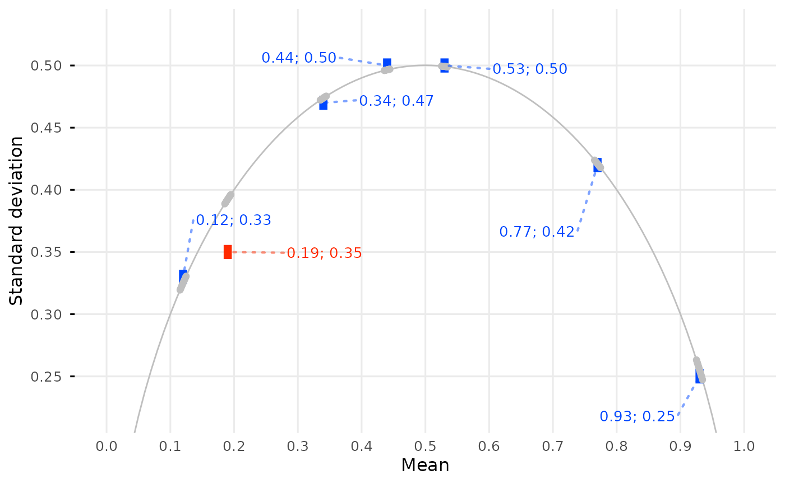

# DEBIT

The descriptive binary test, or DEBIT, checks whether the reported mean,
sample SD, and sample size of binary data are mutually consistent
(Heathers and Brown 2019). In binary data, the mean determines the SD:
if $`k`$ of $`n`$ values are 1, the mean is $`k / n`$, and the sample SD
follows from $`k`$ and $`n`$. DEBIT checks whether there is any $`k`$
for which both the mean and the SD would be reported as the given
values.

DEBIT is a narrow method: it applies only to binary data, such as yes/no
answers or the share of participants in some category. That is why this
vignette covers everything at once, unlike the basics and in-depth
vignettes for GRIM and GRIMMER.

### Single cases: `debit()`

``` r

debit(x = 0.35, sd = 0.18, n = 20, digits_x = 2, digits_sd = 2, data_type = "integer")
#> [1] FALSE
```

As in [`grim()`](https://lhdjung.github.io/scrutiny/reference/grim.md),
the numbers of decimal places must be given, because numeric values lose
trailing zeros. So must `data_type`, which is `"integer"` for the binary
values 0 and 1; see
[`vignette("grim")`](https://lhdjung.github.io/scrutiny/articles/grim.md).
The SD is taken to be a sample SD; for a population SD, which divides by
$`n`$ rather than $`n - 1`$, set `sd_meaning = "sd_pop"`, as in
[`vignette("grimmer-in-depth")`](https://lhdjung.github.io/scrutiny/articles/grimmer-in-depth.md).

By default (`formula = "exact"`), DEBIT only considers means that `n`
binary values can have, that is, `k / n` for a whole number `k`. The
original formulation treats the mean as continuous, so it accepts some
SDs that no binary sample of size `n` can have. `formula = "mean_n"`
reproduces it.

### Many cases: `debit_map()`

[`debit_map()`](https://lhdjung.github.io/scrutiny/reference/debit_map.md)
tests every row of a data frame. These example data are made up:

``` r

flying_pigs <- tibble::tibble(
  x = c(0.4, 0.62, 0.95, 0.38, 0.96),
  sd = c(0.49, 0.49, 0.22, 0.29, 0.20),
  n = 1000,
)

flying_pigs |>
  debit_map(digits_x = 2, digits_sd = 2, data_type = "integer")
#> # A tibble: 5 × 7
#> # DEBIT: default settings
#>       x    sd     n data_type digits_x digits_sd consistency
#>   <dbl> <dbl> <int> <chr>        <int>     <int> <lgl>      
#> 1  0.4   0.49  1000 integer          2         2 TRUE       
#> 2  0.62  0.49  1000 integer          2         2 TRUE       
#> 3  0.95  0.22  1000 integer          2         2 TRUE       
#> 4  0.38  0.29  1000 integer          2         2 FALSE      
#> 5  0.96  0.2   1000 integer          2         2 TRUE
```

With `show_rec = TRUE`, the output also has the reconstructed values:
the rounding bounds of `sd` and `x` (`sd_incl_lower` and `sd_incl_upper`
say whether the bounds of `sd` are included), and `sum_lower` and
`sum_upper`, the smallest and largest numbers of ones whose mean would
be reported as `x`. `pigs3` is an example dataset that comes with
scrutiny:

``` r

pigs3
#> # A tibble: 7 × 3
#>       x    sd     n
#>   <dbl> <dbl> <dbl>
#> 1  0.53  0.5   1683
#> 2  0.44  0.5   1683
#> 3  0.77  0.42  1683
#> 4  0.19  0.35  1683
#> 5  0.34  0.47  1683
#> 6  0.93  0.25  1683
#> 7  0.12  0.33  1683

pigs3 |>
  debit_map(digits_x = 2, digits_sd = 2, data_type = "integer", show_rec = TRUE)
#> # A tibble: 7 × 15
#> # DEBIT: show_rec = TRUE
#>       x    sd     n data_type digits_x digits_sd consistency sd_lower
#>   <dbl> <dbl> <int> <chr>        <int>     <int> <lgl>          <dbl>
#> 1  0.53  0.5   1683 integer          2         2 TRUE           0.495
#> 2  0.44  0.5   1683 integer          2         2 TRUE           0.495
#> 3  0.77  0.42  1683 integer          2         2 TRUE           0.415
#> 4  0.19  0.35  1683 integer          2         2 FALSE          0.345
#> 5  0.34  0.47  1683 integer          2         2 TRUE           0.465
#> 6  0.93  0.25  1683 integer          2         2 TRUE           0.245
#> 7  0.12  0.33  1683 integer          2         2 TRUE           0.325
#> # ℹ 7 more variables: sd_incl_lower <lgl>, sd_upper <dbl>, sd_incl_upper <lgl>,
#> #   x_lower <dbl>, x_upper <dbl>, sum_lower <dbl>, sum_upper <dbl>
```

DEBIT applies to binary data only, so `x` and `sd` must lie between 0
and 1:

``` r

pigs5 |>
  debit_map(digits_x = 2, digits_sd = 2, data_type = "integer")
#> Error in `debit_map()`:
#> ! DEBIT only works with binary summary data.
#> ! Binary mean (`x`) values must range from 0 to 1.
#> ✖ `x` is 7.22.
```

Unlike
[`grim_map()`](https://lhdjung.github.io/scrutiny/reference/grim_map.md),
[`debit_map()`](https://lhdjung.github.io/scrutiny/reference/debit_map.md)
has no `x_meaning` or `items_averaged` argument, since neither applies
to binary data. It takes the same rounding arguments; see
[`vignette("rounding-options", package = "roundwork")`](https://lhdjung.github.io/roundwork/articles/rounding-options.html).

### Explaining consistency results

[`explain_print()`](https://lhdjung.github.io/scrutiny/reference/explain_print.md)
explains the results of
[`debit_map()`](https://lhdjung.github.io/scrutiny/reference/debit_map.md)
step by step, as for GRIM and GRIMMER. Here is the inconsistent value
set from `pigs3`:

``` r

pigs3 |>
  debit_map(digits_x = 2, digits_sd = 2, data_type = "integer") |>
  dplyr::filter(!consistency) |>
  explain_print()
#> DEBIT test: x = 0.19, sd = 0.35, n = 1683, data_type = "integer"
#> 
#> DEBIT is about binary data, where every value is 0 or 1. The mean is then the
#> share of ones, and the SD follows from the number of ones and the sample size.
#> 
#> The mean was reported as 0.19, with 2 decimal places. Before rounding (assuming
#> either rounding up from 5 or down from 5), it could have been anything from
#> 0.185 to 0.195.
#> 
#> With 1683 values, the mean is the number of ones divided by 1683, so that
#> number must be from 0.185 * 1683 = 311.355 to 0.195 * 1683 = 328.185. It has to
#> be an integer, so it can be anything from 312 to 328.
#> 
#> The SD was reported as 0.35, with 2 decimal places. Before rounding, it could
#> have been anything from 0.345 to 0.355.
#> 
#> With k ones among 1683 values, the SD is sqrt(k * (1683 - k) / (1683 * 1682)).
#> Even the smallest of these SDs, for k = 312, is
#> sqrt(312 * 1371 / 2830806) = 0.3887, which is above that range.
#> 
#> ==> Inconsistent
```

[`explain_map()`](https://lhdjung.github.io/scrutiny/reference/explain_map.md)
adds the explanations as an `explanation` column instead, and
[`debit_explain()`](https://lhdjung.github.io/scrutiny/reference/debit_explain.md)
explains a single value set. Only the default `formula = "exact"` can be
explained.

### Single value sets in detail

[`debit_values()`](https://lhdjung.github.io/scrutiny/reference/debit_values.md)
lists the samples behind a value set: each number of ones whose mean and
SD would be reported as the given ones. Seven ones among 20 values have
a mean of 0.35 and an SD of 0.49:

``` r

debit_values(x = 0.35, sd = 0.49, n = 20, digits_x = 2, digits_sd = 2, data_type = "integer")
#> # A tibble: 1 × 5
#>    case     x     sd     n   sum
#>   <int> <dbl>  <dbl> <int> <dbl>
#> 1     1  0.35 0.4894    20     7
```

An SD of 0.41 with the same mean is inconsistent, so
[`debit_values()`](https://lhdjung.github.io/scrutiny/reference/debit_values.md)
would return no rows.
[`debit_closest()`](https://lhdjung.github.io/scrutiny/reference/debit_values.md)
returns the sample whose SD is closest to the reported one instead:

``` r

debit_closest(x = 0.35, sd = 0.41, n = 20, digits_x = 2, digits_sd = 2, data_type = "integer")
#> # A tibble: 1 × 5
#>    case     x     sd     n   sum
#>   <int> <dbl>  <dbl> <int> <dbl>
#> 1     1  0.35 0.4894    20     7
```

Only seven ones give a mean of 0.35 here, so the closest SD is the same
0.49 as above, far from the reported 0.41.

[`debit_plot_line()`](https://lhdjung.github.io/scrutiny/reference/debit_plot_line.md)
draws the SDs that `n` binary values with the reported mean can have,
around the reported SD:

``` r

debit_plot_line(x = 0.35, sd = 0.41, n = 20, digits_x = 2, digits_sd = 2, data_type = "integer")
```


[`sd_binary_groups()`](https://lhdjung.github.io/scrutiny/reference/sd-binary.md)
computes the SD of binary data from the numbers of zeros and ones, and
[`sd_binary_mean_n()`](https://lhdjung.github.io/scrutiny/reference/sd-binary.md)
from the mean and the sample size:

``` r

sd_binary_groups(group_0 = 13, group_1 = 7)
#> [1] 0.4893605
sd_binary_mean_n(x = 0.35, n = 20)
#> [1] 0.4893605
```

Both take `sd_meaning`, as
[`debit()`](https://lhdjung.github.io/scrutiny/reference/debit.md) does,
for a population SD or a standard error.

### Summaries with `audit()`

``` r

pigs3 |>
  debit_map(digits_x = 2, digits_sd = 2, data_type = "integer") |>
  audit()
#> # A tibble: 1 × 6
#>   all_cases incon_cases emp_incon mean_x mean_sd distinct_n
#>       <int>       <int>     <dbl>  <dbl>   <dbl>      <int>
#> 1         7           1    0.1429 0.4743  0.4029          1
```

- `all_cases`, `incon_cases`, `emp_incon`: the total number of value
  sets, the number of inconsistent ones, and their ratio.
- `mean_x`, `mean_sd`: the means of the reported means and SDs.
- `distinct_n`: the number of distinct sample sizes.

### Visualization with `debit_plot()`

[`debit_plot()`](https://lhdjung.github.io/scrutiny/reference/debit_plot.md)
takes the output of
[`debit_map()`](https://lhdjung.github.io/scrutiny/reference/debit_map.md).
It needs the ggrepel package for its labels.

``` r

# `theme_set()` applies to all later plots in the session:
ggplot2::theme_minimal(base_size = 12) |>
  ggplot2::theme_set()

pigs3 |>
  debit_map(digits_x = 2, digits_sd = 2, data_type = "integer") |>
  debit_plot()
```



The arc is the DEBIT line: the SD of binary data as a function of their
mean, for the given sample size. The points on it are the means that `n`
binary values can have. Each value set is a rectangle spanning the
rounding bounds of its mean and SD, drawn over a point at the reported
values in case the rectangle is too small to see. Under
`formula = "exact"`, a value set is consistent if one of the points lies
inside its rectangle. Consistent sets are blue, inconsistent ones red;
see
[`?debit_plot`](https://lhdjung.github.io/scrutiny/reference/debit_plot.md)
for other colors. If `n` varies, the lines for the smallest and largest
`n` are drawn and the band between them is shaded.

### Values around the reported ones: `debit_map_seq()`

[`debit_map_seq()`](https://lhdjung.github.io/scrutiny/reference/debit_map_seq.md)
varies `x`, `sd`, and `n` around the reported values and tests each
result:

``` r

out_seq1 <- debit_map_seq(pigs3, digits_x = 2, digits_sd = 2, data_type = "integer")
out_seq1
#> # A tibble: 30 × 10
#> # DEBIT: default settings
#>        x    sd     n data_type digits_x digits_sd consistency diff_var  case
#>    <dbl> <dbl> <int> <chr>        <int>     <int> <lgl>          <int> <int>
#>  1  0.14  0.35  1683 integer          2         2 TRUE              -5     4
#>  2  0.15  0.35  1683 integer          2         2 TRUE              -4     4
#>  3  0.16  0.35  1683 integer          2         2 FALSE             -3     4
#>  4  0.17  0.35  1683 integer          2         2 FALSE             -2     4
#>  5  0.18  0.35  1683 integer          2         2 FALSE             -1     4
#>  6  0.2   0.35  1683 integer          2         2 FALSE              1     4
#>  7  0.21  0.35  1683 integer          2         2 FALSE              2     4
#>  8  0.22  0.35  1683 integer          2         2 FALSE              3     4
#>  9  0.23  0.35  1683 integer          2         2 FALSE              4     4
#> 10  0.24  0.35  1683 integer          2         2 FALSE              5     4
#> # ℹ 20 more rows
#> # ℹ 1 more variable: var <chr>

audit(out_seq1)
#> # A tibble: 1 × 18
#>       x    sd     n data_type consistency hits_total hits_x hits_sd hits_n
#>   <dbl> <dbl> <int> <chr>     <lgl>            <int>  <int>   <int>  <int>
#> 1  0.19  0.35  1683 integer   FALSE                4      2       2      0
#> # ℹ 9 more variables: diff_x <int>, diff_x_up <int>, diff_x_down <int>,
#> #   diff_sd <int>, diff_sd_up <int>, diff_sd_down <int>, diff_n <int>,
#> #   diff_n_up <int>, diff_n_down <int>
```

As for GRIM and GRIMMER, the `hits_*` columns count the consistent value
sets found, and the `diff_*` columns give the distance to the nearest
one in dispersion steps. `include_consistent = TRUE` disperses the
consistent value sets as well:

``` r

out_seq2 <- debit_map_seq(
  pigs3,
  digits_x = 2,
  digits_sd = 2,
  data_type = "integer",
  dispersion = 1:7,
  include_consistent = TRUE
)
audit(out_seq2)
#> # A tibble: 7 × 18
#>       x    sd     n data_type consistency hits_total hits_x hits_sd hits_n
#>   <dbl> <dbl> <int> <chr>     <lgl>            <int>  <int>   <int>  <int>
#> 1  0.53  0.5   1683 integer   TRUE                25     11       0     14
#> 2  0.44  0.5   1683 integer   TRUE                22      8       0     14
#> 3  0.77  0.42  1683 integer   TRUE                16      2       0     14
#> 4  0.19  0.35  1683 integer   FALSE                4      2       2      0
#> 5  0.34  0.47  1683 integer   TRUE                17      2       1     14
#> 6  0.93  0.25  1683 integer   TRUE                16      1       1     14
#> 7  0.12  0.33  1683 integer   TRUE                16      1       1     14
#> # ℹ 9 more variables: diff_x <int>, diff_x_up <int>, diff_x_down <int>,
#> #   diff_sd <int>, diff_sd_up <int>, diff_sd_down <int>, diff_n <int>,
#> #   diff_n_up <int>, diff_n_down <int>
```

[`debit_plot()`](https://lhdjung.github.io/scrutiny/reference/debit_plot.md)
accepts this output, but the dispersed value sets overlap into a cross
around each case, and their labels crowd each other out.

### Unknown group sizes: `debit_map_total_n()`

If only the total sample size of two groups is known,
[`debit_map_total_n()`](https://lhdjung.github.io/scrutiny/reference/debit_map_total_n.md)
tests hypothetical splits of it, as
[`grim_map_total_n()`](https://lhdjung.github.io/scrutiny/reference/grim_map_total_n.md)
does; see
[`vignette("grim-in-depth")`](https://lhdjung.github.io/scrutiny/articles/grim-in-depth.md)
for a case study.

``` r

flying_pigs2 <- tibble::tribble(
  ~x1  , ~x2  , ~sd1 , ~sd2 , ~n ,
  0.30 , 0.27 , 0.47 , 0.45 , 70 ,
  0.43 , 0.34 , 0.50 , 0.48 , 65
)

out_total_n <- debit_map_total_n(flying_pigs2, digits_x = 2, digits_sd = 2, data_type = "integer")
out_total_n
#> # A tibble: 46 × 11
#> # DEBIT: default settings
#>        x    sd     n n_change data_type digits_x digits_sd consistency
#>    <dbl> <dbl> <int>    <int> <chr>        <int>     <int> <lgl>      
#>  1  0.3   0.47    35        0 integer          2         2 FALSE      
#>  2  0.27  0.45    35        0 integer          2         2 FALSE      
#>  3  0.3   0.47    34       -1 integer          2         2 FALSE      
#>  4  0.27  0.45    36        1 integer          2         2 FALSE      
#>  5  0.3   0.47    33       -2 integer          2         2 TRUE       
#>  6  0.27  0.45    37        2 integer          2         2 TRUE       
#>  7  0.3   0.47    32       -3 integer          2         2 FALSE      
#>  8  0.27  0.45    38        3 integer          2         2 FALSE      
#>  9  0.3   0.47    31       -4 integer          2         2 FALSE      
#> 10  0.27  0.45    39        4 integer          2         2 FALSE      
#> # ℹ 36 more rows
#> # ℹ 3 more variables: both_consistent <lgl>, case <int>, dir <fct>

audit(out_total_n)
#> # A tibble: 2 × 10
#>      x1    x2   sd1   sd2     n hits_total hits_forth hits_back scenarios_total
#>   <dbl> <dbl> <dbl> <dbl> <int>      <int>      <int>     <int>           <int>
#> 1  0.3   0.27  0.47  0.45    70          2          2         0              11
#> 2  0.43  0.34  0.5   0.48    65          1          1         0              12
#> # ℹ 1 more variable: hit_rate <dbl>
```

### Interpreting results

An inconsistency means that an assumption of the test is false or that a
number was reported incorrectly, often for a benign reason. What to rule
out before drawing conclusions is discussed in [the section on
interpreting GRIM
results](https://trustworthyresear.ch/chapters/granularity_methods.html#sec-grim-interpreting)
of Hussey (2026). The same reasoning applies to DEBIT.

## References

Heathers, James A. J., and Nicholas J. L. Brown. 2019. *DEBIT: A Simple
Consistency Test For Binary Data*. <https://osf.io/5vb3u/>.

Hussey, Ian. 2026. *Trustworthiness Assessment and Forensic
Meta-Science*. <https://doi.org/10.5281/zenodo.23056120>.
