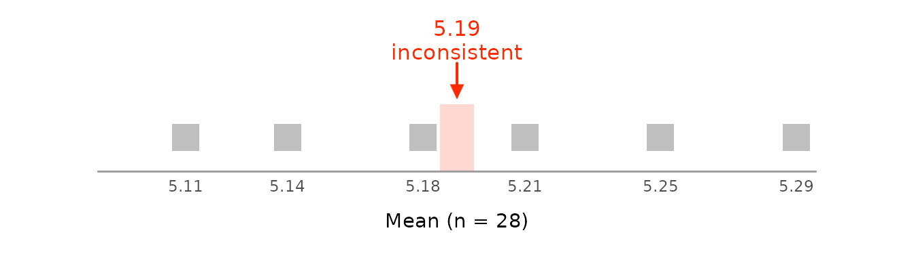
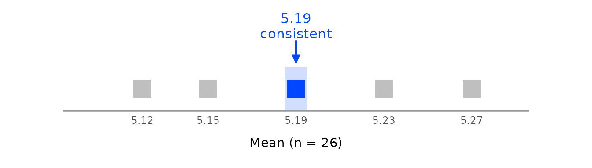
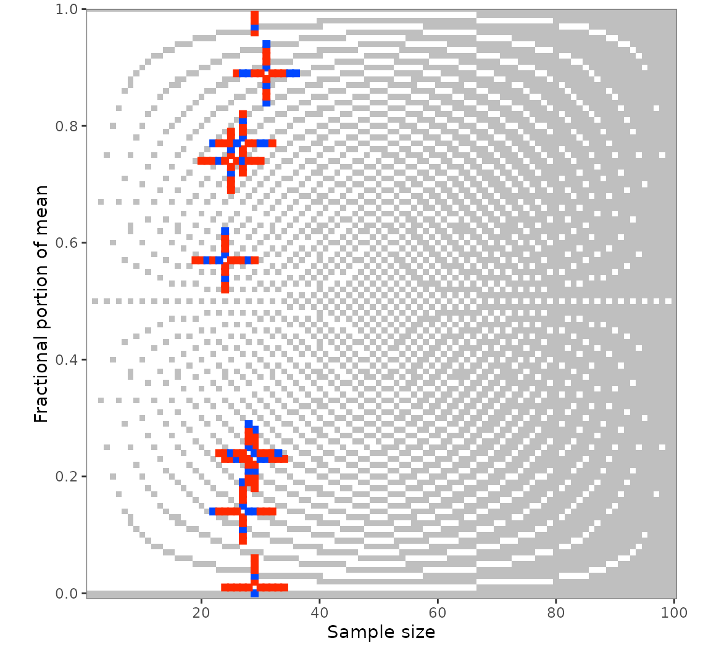
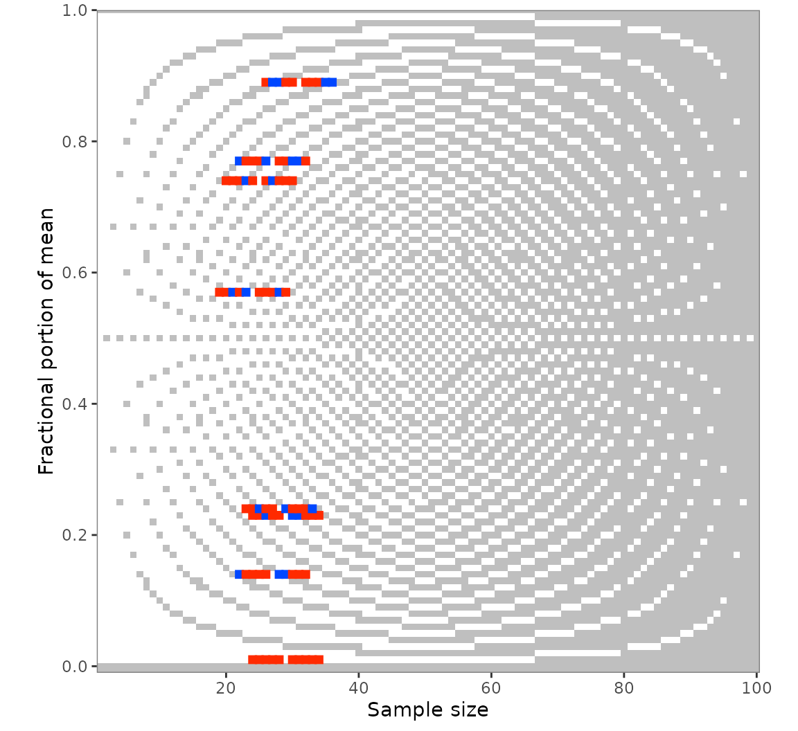
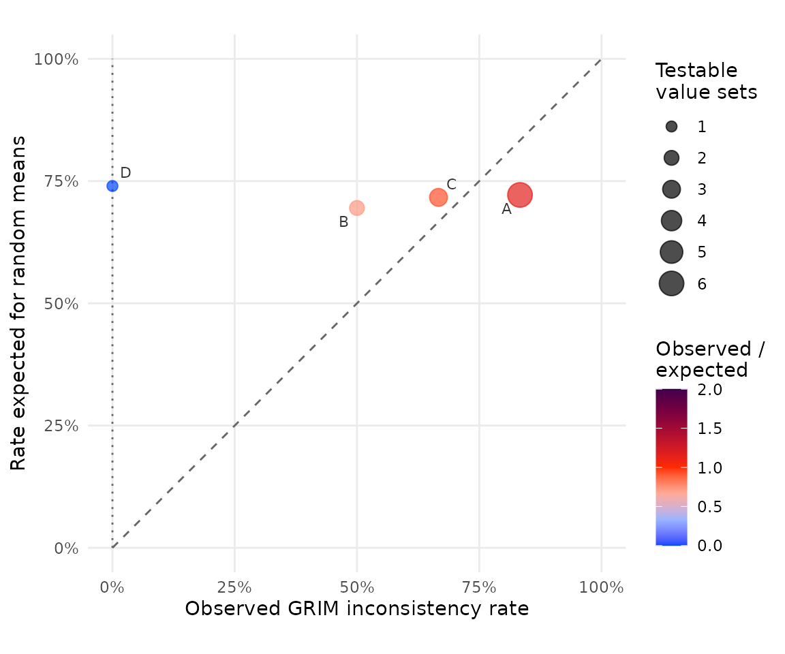

# GRIM in depth

This vignette builds on
[`vignette("grim")`](https://lhdjung.github.io/scrutiny/articles/grim.md),
which covers the basics of GRIM testing with
[`grim()`](https://lhdjung.github.io/scrutiny/reference/grim.md) and
[`grim_map()`](https://lhdjung.github.io/scrutiny/reference/grim_map.md).
Here are the numbers behind a test result, the settings recorded with
it, the values around the reported ones with
[`grim_map_seq()`](https://lhdjung.github.io/scrutiny/reference/grim_map_seq.md)
and
[`grim_map_total_n()`](https://lhdjung.github.io/scrutiny/reference/grim_map_total_n.md),
and the GRIM statistics behind the `exp_incon` column.

### Behind a test result

#### Reconstructed values

With `show_rec = TRUE`, the output includes the numbers on which the
test result is based:

``` r

pigs1 |>
  grim_map(digits_x = 2, items_averaged = 1, data_type = "integer", show_rec = TRUE) |>
  dplyr::select(x, n, consistency, rec_sum:rec_x_lower)
#> # A tibble: 12 × 8
#> # GRIM: show_rec = TRUE
#>        x     n consistency rec_sum sum_lower sum_upper rec_x_upper rec_x_lower
#>    <dbl> <int> <lgl>         <dbl>     <dbl>     <dbl>       <dbl>       <dbl>
#>  1  7.22    32 TRUE         231.0        231       231       7.25       7.219 
#>  2  4.74    25 FALSE        118.5        119       118       4.76       4.72  
#>  3  5.23    29 FALSE        151.7        152       151       5.241      5.207 
#>  4  2.57    24 FALSE         61.68        62        61       2.583      2.542 
#>  5  6.77    27 FALSE        182.8        183       182       6.778      6.741 
#>  6  2.68    28 TRUE          75.04        75        75       2.714      2.679 
#>  7  7.01    29 FALSE        203.3        204       203       7.034      7     
#>  8  7.38    26 TRUE         191.9        192       192       7.385      7.346 
#>  9  3.14    27 FALSE         84.78        85        84       3.148      3.111 
#> 10  6.89    31 FALSE        213.6        214       213       6.903      6.871 
#> 11  5       25 TRUE         125          125       125       5          5     
#> 12  0.24    28 FALSE          6.72         7         6       0.25       0.2143
```

- `rec_sum` is `x * n * items_averaged`, the sum implied by the reported
  mean. The sum of integer data is a whole number, which `rec_sum`
  generally is not.
- `sum_lower` and `sum_upper` are the smallest and largest whole-number
  sums that would have been reported as `x`. A value set is consistent
  if and only if `sum_lower <= sum_upper`. If it is inconsistent, they
  are the whole numbers just above and below `rec_sum`, so their
  difference is always 1 and says nothing about how far off the mean is.
- `rec_x_upper` and `rec_x_lower` are the two achievable means closest
  to `x`: `rec_sum` rounded up and down, divided by
  `n * items_averaged`. They show how far the reported mean is from an
  achievable one. With `x_meaning = "percentage"`, they are percentages
  like `x`.

#### Recorded settings

A mapper records the settings of its call on its output, so that a
report can state the conditions of each result.
[`scrutiny_meta()`](https://lhdjung.github.io/scrutiny/reference/scrutiny_meta.md)
returns them:

``` r

pigs1 |>
  grim_map(digits_x = 2, items_averaged = 1, data_type = "integer", rounding = "up") |>
  scrutiny_meta()
#> # A tibble: 5 × 4
#>   setting   value  default added_by
#>   <chr>     <chr>  <lgl>   <chr>   
#> 1 x_meaning 'mean' TRUE    grim_map
#> 2 rounding  'up'   FALSE   grim_map
#> 3 threshold 5      TRUE    grim_map
#> 4 symmetric FALSE  TRUE    grim_map
#> 5 show_rec  FALSE  TRUE    grim_map
```

`default` says whether a setting was left at its default.
[`explain_map()`](https://lhdjung.github.io/scrutiny/reference/explain_map.md)
and
[`grim_plot_grid()`](https://lhdjung.github.io/scrutiny/reference/grim_plot_grid.md)
read the settings from there, so they apply the same rounding method as
the call. For the same reason,
[`dplyr::bind_rows()`](https://dplyr.tidyverse.org/reference/bind_rows.html)
refuses to combine the output of calls with different settings, whose
rows would otherwise be read under the first call’s settings.

#### Achievable means

[`grim_values()`](https://lhdjung.github.io/scrutiny/reference/grim_values.md)
returns all means that a sample of `n` integers can have and that would
be reported as `x`, each with the whole-number sum behind it:

``` r

grim_values(x = 5.19, n = 32, digits_x = 2, items_averaged = 1, data_type = "integer")
#> # A tibble: 1 × 5
#>    case     x     n items_averaged   sum
#>   <int> <dbl> <int>          <int> <dbl>
#> 1     1 5.188    32              1   166
grim_values(x = 5.19, n = 300, digits_x = 2, items_averaged = 1, data_type = "integer")
#> # A tibble: 3 × 5
#>    case     x     n items_averaged   sum
#>   <int> <dbl> <int>          <int> <dbl>
#> 1     1 5.187   300              1  1556
#> 2     1 5.19    300              1  1557
#> 3     1 5.193   300              1  1558
grim_values(x = 5.19, n = 28, digits_x = 2, items_averaged = 1, data_type = "integer") # inconsistent: none
#> # A tibble: 0 × 5
#> # ℹ 5 variables: case <int>, x <dbl>, n <int>, items_averaged <int>, sum <dbl>
```

[`grim_closest()`](https://lhdjung.github.io/scrutiny/reference/grim_values.md)
returns the achievable mean nearest to `x`, with the sum behind it, in
one row per value set. If `x` is consistent, that is the nearest one
that would be reported as `x`:

``` r

grim_closest(x = 5.19, n = 28, digits_x = 2, items_averaged = 1, data_type = "integer")
#> # A tibble: 1 × 5
#>    case     x     n items_averaged   sum
#>   <int> <dbl> <int>          <int> <dbl>
#> 1     1 5.179    28              1   145
```

Both functions are vectorized. A reported mean may have one achievable
mean, several, or none, so
[`grim_values()`](https://lhdjung.github.io/scrutiny/reference/grim_values.md)
returns one row per achievable mean, and `case` says which value set it
belongs to. An inconsistent value set has no rows:

``` r

grim_values(
  x = c(5.19, 5.19, 5.19),
  n = c(32, 300, 28),
  digits_x = 2,
  items_averaged = 1,
  data_type = "integer"
)
#> # A tibble: 4 × 5
#>    case     x     n items_averaged   sum
#>   <int> <dbl> <int>          <int> <dbl>
#> 1     1 5.188    32              1   166
#> 2     2 5.187   300              1  1556
#> 3     2 5.19    300              1  1557
#> 4     2 5.193   300              1  1558
```

To line the values up with the data they came from, number its rows as
`case` and join. An inner join leaves out the inconsistent rows, and
`suffix` keeps the achievable `x` apart from the reported one:

``` r

pigs1 |>
  dplyr::mutate(case = dplyr::row_number()) |>
  dplyr::inner_join(
    grim_values(pigs1$x, pigs1$n, digits_x = 2, items_averaged = 1, data_type = "integer"),
    by = "case",
    suffix = c("", "_achievable")
  )
#> # A tibble: 4 × 7
#>       x     n  case x_achievable n_achievable items_averaged   sum
#>   <dbl> <dbl> <int>        <dbl>        <int>          <int> <dbl>
#> 1  7.22    32     1        7.219           32              1   231
#> 2  2.68    28     6        2.679           28              1    75
#> 3  7.38    26     8        7.385           26              1   192
#> 4  5       25    11        5               25              1   125
```

Once `n * items_averaged` is at least `10^digits_x`, every mean is
achievable and GRIM cannot detect anything. The number of achievable
means can then become very large, which is why
[`grim_map()`](https://lhdjung.github.io/scrutiny/reference/grim_map.md)
does not return them.

#### A single value set: `grim_plot_line()`

[`grim_plot_line()`](https://lhdjung.github.io/scrutiny/reference/grim_plot_line.md)
draws the test for one value set, which helps to explain a result. Of
all means that could have been reported with `digits_x` decimal places,
it draws a square for each one that a sample of size `n` can have and
leaves the others out. The reported value is marked above the row, and
the strip behind the squares is the range of unrounded means that would
have been reported as `x`. The value set is consistent if a square
stands within the strip:

``` r

grim_plot_line(x = 5.19, n = 28, digits_x = 2, items_averaged = 1, data_type = "integer")
```



With `n = 26`, the same mean is consistent:

``` r

grim_plot_line(x = 5.19, n = 26, digits_x = 2, items_averaged = 1, data_type = "integer")
```



By default, the plot shows the reported value and the nearest achievable
one. `zoom = "medium"` widens it to the nearest achievable value on
either side, and `zoom = "wide"` to a whole unit.

[`grimmer_plot_line()`](https://lhdjung.github.io/scrutiny/reference/grimmer_plot_line.md)
is the same figure over standard deviations; see
[`vignette("grimmer-in-depth")`](https://lhdjung.github.io/scrutiny/articles/grimmer-in-depth.md).

#### The grid behind `grim_plot_grid()`

[`grim_grid()`](https://lhdjung.github.io/scrutiny/reference/grim_grid.md)
returns the grid behind the raster of
[`grim_plot_grid()`](https://lhdjung.github.io/scrutiny/reference/grim_plot_grid.md)
as a tibble, with GRIM’s result for every cell. It is useful for
studying GRIM itself, e.g., the share of means it rules out at each
sample size:

``` r

grim_grid(digits_x = 2, data_type = "integer") |>
  dplyr::summarise(share_inconsistent = mean(!consistency), .by = n)
#> # A tibble: 100 × 2
#>        n share_inconsistent
#>    <int>              <dbl>
#>  1     1             1     
#>  2     2             0.9899
#>  3     3             0.9798
#>  4     4             0.9697
#>  5     5             0.9596
#>  6     6             0.9495
#>  7     7             0.9394
#>  8     8             0.8889
#>  9     9             0.9192
#> 10    10             0.9091
#> # ℹ 90 more rows
```

### Values around the reported ones: `grim_map_seq()`

An inconsistency may come from a small error in reporting or computing.
[`grim_map_seq()`](https://lhdjung.github.io/scrutiny/reference/grim_map_seq.md)
varies `x` and `n` a few steps up and down, one at a time, and tests
each resulting value set:

``` r

out_seq1 <- grim_map_seq(pigs1, digits_x = 2, items_averaged = 1, data_type = "integer")
out_seq1
#> # A tibble: 160 × 10
#> # GRIM: default settings
#>        x     n items_averaged data_type digits_x consistency exp_incon diff_var
#>    <dbl> <int>          <int> <chr>        <int> <lgl>           <dbl>    <int>
#>  1  4.69    25              1 integer          2 FALSE            0.75       -5
#>  2  4.7     25              1 integer          2 FALSE            0.75       -4
#>  3  4.71    25              1 integer          2 FALSE            0.75       -3
#>  4  4.72    25              1 integer          2 TRUE             0.75       -2
#>  5  4.73    25              1 integer          2 FALSE            0.75       -1
#>  6  4.75    25              1 integer          2 FALSE            0.75        1
#>  7  4.76    25              1 integer          2 TRUE             0.75        2
#>  8  4.77    25              1 integer          2 FALSE            0.75        3
#>  9  4.78    25              1 integer          2 FALSE            0.75        4
#> 10  4.79    25              1 integer          2 FALSE            0.75        5
#> # ℹ 150 more rows
#> # ℹ 2 more variables: case <int>, var <chr>
```

By default, only inconsistent value sets are dispersed. `case` is the
row in the input data, `var` the variable that was varied, and
`diff_var` the number of steps from the reported value.

#### Summaries with `audit()`

[`audit()`](https://lhdjung.github.io/scrutiny/reference/audit.md)
summarizes this output per case:

``` r

audit(out_seq1)
#> # A tibble: 8 × 14
#>       x     n items_averaged data_type consistency hits_total hits_x hits_n
#>   <dbl> <int>          <int> <chr>     <lgl>            <int>  <int>  <int>
#> 1  4.74    25              1 integer   FALSE                4      2      2
#> 2  5.23    29              1 integer   FALSE                6      3      3
#> 3  2.57    24              1 integer   FALSE                6      3      3
#> 4  6.77    27              1 integer   FALSE                7      3      4
#> 5  7.01    29              1 integer   FALSE                3      3      0
#> 6  3.14    27              1 integer   FALSE                6      3      3
#> 7  6.89    31              1 integer   FALSE                8      4      4
#> 8  0.24    28              1 integer   FALSE                6      3      3
#> # ℹ 6 more variables: diff_x <int>, diff_x_up <int>, diff_x_down <int>,
#> #   diff_n <int>, diff_n_up <int>, diff_n_down <int>
```

- `x` and `n` are the reported values, and `consistency` their test
  result.
- `hits_total`, `hits_x`, `hits_n`: the number of consistent value sets
  found, in total and by varying each variable.
- `diff_x`: the distance from `x` to the nearest consistent value, in
  dispersion steps. `diff_x_up` and `diff_x_down` are the distances to
  the nearest consistent value above and below. The `diff_n*` columns
  are the same for `n`.

The default `dispersion` is `1:5`, for five steps up and down. With more
steps, more hits are typically found:

``` r

out_seq2 <- grim_map_seq(
  pigs1,
  digits_x = 2,
  items_averaged = 1,
  data_type = "integer",
  dispersion = 1:10
)
audit(out_seq2)
#> # A tibble: 8 × 14
#>       x     n items_averaged data_type consistency hits_total hits_x hits_n
#>   <dbl> <int>          <int> <chr>     <lgl>            <int>  <int>  <int>
#> 1  4.74    25              1 integer   FALSE               12      6      6
#> 2  5.23    29              1 integer   FALSE               12      6      6
#> 3  2.57    24              1 integer   FALSE               11      6      5
#> 4  6.77    27              1 integer   FALSE               11      6      5
#> 5  7.01    29              1 integer   FALSE                6      6      0
#> 6  3.14    27              1 integer   FALSE               13      6      7
#> 7  6.89    31              1 integer   FALSE               12      6      6
#> 8  0.24    28              1 integer   FALSE               13      6      7
#> # ℹ 6 more variables: diff_x <int>, diff_x_up <int>, diff_x_down <int>,
#> #   diff_n <int>, diff_n_up <int>, diff_n_down <int>
```

[`explain_print()`](https://lhdjung.github.io/scrutiny/reference/explain_print.md)
explains the rows of this output like those of
[`grim_map()`](https://lhdjung.github.io/scrutiny/reference/grim_map.md),
so you can see why a nearby value passes:

``` r

out_seq1 |>
  dplyr::filter(consistency) |>
  explain_print(1)
#> GRIM test: x = 4.72, n = 25, items_averaged = 1, data_type = "integer"
#> 
#> The mean was reported as 4.72, with 2 decimal places. Before rounding (assuming
#> either rounding up from 5 or down from 5), it could have been anything from
#> 4.715 to 4.725.
#> 
#> The mean of 25 integers is their sum divided by 25. So the sum must be from
#> 4.715 * 25 = 117.875 to 4.725 * 25 = 118.125.
#> 
#> A sum of integers is itself an integer, and 118 is in this range:
#> 118 / 25 = 4.72, which rounds to 4.72.
#> 
#> ==> Consistent
```

#### Plotting dispersed values

[`grim_plot_grid()`](https://lhdjung.github.io/scrutiny/reference/grim_plot_grid.md)
accepts this output. Each reported value set appears as a cross: the
horizontal arm consists of the dispersed `n` values, the vertical arm of
the dispersed `x` values:

``` r

grim_plot_grid(out_seq1)
```



Restrict the dispersion to one variable with `var`:

``` r

out_seq1_only_n <- grim_map_seq(
  pigs1,
  digits_x = 2,
  items_averaged = 1,
  data_type = "integer",
  var = "n"
)
grim_plot_grid(out_seq1_only_n)
```



### Unknown group sizes: `grim_map_total_n()`

Some studies report group means but only the total sample size. GRIM can
then test hypothetical group sizes: start from an even split, move one
participant at a time from one group to the other, and record which
splits make both means consistent.
[`grim_map_total_n()`](https://lhdjung.github.io/scrutiny/reference/grim_map_total_n.md)
does this, following an analysis by Bauer and Francis (2021).

The study they examined reported means of 4.71 and 5.3 for a total of 40
participants. With 20 in each group, only 5.3 is consistent. Bauer and
Francis moved to 19/21, 18/22, and 17/23, and found that both means are
consistent at 17/23 with 4.71 in the smaller group.

``` r

df <- tibble::tibble(x1 = 4.71, x2 = 5.3, n = 40)

df_tested <- grim_map_total_n(df, digits_x = c(2, 1), items_averaged = 1, data_type = "integer")
df_tested
#> # A tibble: 22 × 11
#> # GRIM: default settings
#>        x     n n_change items_averaged data_type digits_x consistency
#>    <dbl> <int>    <int>          <int> <chr>        <int> <lgl>      
#>  1  4.71    20        0              1 integer          2 FALSE      
#>  2  5.3     20        0              1 integer          1 TRUE       
#>  3  4.71    19       -1              1 integer          2 FALSE      
#>  4  5.3     21        1              1 integer          1 TRUE       
#>  5  4.71    18       -2              1 integer          2 FALSE      
#>  6  5.3     22        2              1 integer          1 TRUE       
#>  7  4.71    17       -3              1 integer          2 TRUE       
#>  8  5.3     23        3              1 integer          1 TRUE       
#>  9  4.71    16       -4              1 integer          2 FALSE      
#> 10  5.3     24        4              1 integer          1 TRUE       
#> # ℹ 12 more rows
#> # ℹ 4 more variables: both_consistent <lgl>, exp_incon <dbl>, case <int>,
#> #   dir <fct>

audit(df_tested)
#> # A tibble: 1 × 8
#>      x1    x2     n hits_total hits_forth hits_back scenarios_total hit_rate
#>   <dbl> <dbl> <int>      <int>      <int>     <int>           <int>    <dbl>
#> 1  4.71   5.3    40          3          1         2              11   0.2727
```

Each row is one mean with one hypothetical group size. `n_change` is how
far that size is from half the total, `both_consistent` says whether
both means of the split are consistent, and `dir` says which way the
means were paired with the groups (see below). A hit is a split in which
both means are consistent with their hypothetical group sizes. The
default `dispersion = 0:5` goes five steps away from the even split.

The two means were reported with different numbers of decimal places, so
`digits_x` has one value per group. Testing 5.3 as if it were 5.30 would
be stricter than the test Bauer and Francis conducted.

[`grim_map_total_n()`](https://lhdjung.github.io/scrutiny/reference/grim_map_total_n.md)
tests both ways of pairing the means with the group sizes. Bauer and
Francis only paired 4.71 with the smaller group; the reverse pairing
yields two more hits, at 19/21 and 16/24. In the summary, `hits_forth`
counts the hits from the first pairing, `hits_back` those from the
reverse one, and `hits_total` their sum. `scenarios_total` is the number
of scenarios tested, each a split with one pairing of the means, and
`hit_rate` the share of them that are hits. The even split is the same
scenario under both pairings, so it counts once: six splits make 11
scenarios here.

### GRIM statistics

#### The probability of GRIM inconsistency

The `exp_incon` column of
[`grim_map()`](https://lhdjung.github.io/scrutiny/reference/grim_map.md)
is, for the simplest rounding methods,

``` math
P = \max\left(0, \frac{10^D - NL}{10^D}\right)
```

where $`D`$ is the number of decimal places, $`N`$ the sample size, and
$`L`$ the number of items. This is the probability that a mean with
$`D`$ decimal places but random decimal digits is GRIM-inconsistent with
$`N`$ and $`L`$. If it is 0, GRIM cannot detect any inconsistency.

The formula is exact for rounding methods in which exactly one range of
unrounded values, one rounding step wide, is rounded to each reported
value, such as `"up"`. The default, `"up_or_down"`, accepts a mean
exactly halfway between two reportable values in both directions, so the
formula overstates the probability whenever $`NL < 10^D`$ and
$`NL / \gcd(NL, 10^D)`$ is even: at $`N = 40`$ with two decimal places,
the probability is $`0.4`$, not $`0.6`$. Under `"ceiling_or_floor"`, the
range is two steps wide.
[`grim_exp_incon()`](https://lhdjung.github.io/scrutiny/reference/grim-stats.md)
and
[`grim_total()`](https://lhdjung.github.io/scrutiny/reference/grim-stats.md)
therefore take `rounding` and `threshold` arguments and count exactly
the values that
[`grim()`](https://lhdjung.github.io/scrutiny/reference/grim.md) would
reject.
[`grim_map()`](https://lhdjung.github.io/scrutiny/reference/grim_map.md)
passes its own `rounding` on.

``` r

grim_exp_incon(x = 1.40, n = 72, digits_x = 2, items_averaged = 1, data_type = "integer")
#> [1] 0.24

grim_exp_incon(x = 5.93, n = 80, digits_x = 2, items_averaged = 3, data_type = "integer")
#> [1] 0

grim_exp_incon(
  x = 84.27,
  n = 40,
  digits_x = 2,
  items_averaged = 1,
  data_type = "integer",
  x_meaning = "percentage"
)
#> [1] 0.996
```

[`grim_total()`](https://lhdjung.github.io/scrutiny/reference/grim-stats.md)
returns a count instead of a proportion: the number of the $`10^D`$
possible fractional parts that are inconsistent:

``` r

grim_total(x = 1.40, n = 72, digits_x = 2, items_averaged = 1, data_type = "integer")
#> [1] 24
```

The formula is implicit in Brown and Heathers (2017), who note (p. 367)
that with two decimal places and $`N < 100`$, a random mean is
consistent in about $`N`$% of cases.

#### A study’s rate of inconsistency

Correctly reported means are always consistent, so a study’s rate of
inconsistent value sets should be zero. If the decimal digits of its
means were random, that rate would be expected to be the mean of the
`exp_incon` column.
[`grim_binomial()`](https://lhdjung.github.io/scrutiny/reference/grim_binomial.md)
tests whether the rate of *consistent* value sets is above what random
digits would produce. It uses the Poisson binomial distribution, since
the probability differs between value sets, and returns the observed
consistency rate with a Clopper-Pearson confidence interval:

``` r

pigs1 |>
  grim_map(digits_x = 2, items_averaged = 1, data_type = "integer") |>
  grim_binomial()
#> # A tibble: 1 × 9
#>   estimate statistic p.value parameter conf.low conf.high conf.level method     
#>      <dbl>     <int>   <dbl>     <int>    <dbl>     <dbl>      <dbl> <chr>      
#> 1   0.3333         4  0.4531        12   0.1229         1       0.95 Poisson bi…
#> # ℹ 1 more variable: alternative <chr>
```

[`grim_binomial_power()`](https://lhdjung.github.io/scrutiny/reference/grim_binomial_power.md)
computes the power of this test for a given number of value sets, so you
can judge whether the test is informative before interpreting its
p-value:

``` r

grim_binomial_power(p0 = 0.5, p1 = 0.9, k = 10)
#> [1] 0.7360989
```

Both functions are experimental.
[`grim_plot_rates()`](https://lhdjung.github.io/scrutiny/reference/grim_plot_rates.md)
shows the same comparison for several studies. Each point is a study,
placed at its observed rate of inconsistency against the rate that
random means would show; the point area is the number of testable value
sets. A study on the dotted line at zero is as expected, and one on the
dashed diagonal is as inconsistent as random digits:

``` r

# fmt: skip
codes <- c(
  "B", "B", "C", "C", "A", "C",
  "A", "D", "A", "A", "A", "A"
)

pigs1 |>
  grim_map(digits_x = 2, items_averaged = 1, data_type = "integer") |>
  dplyr::mutate(study = codes) |>
  grim_plot_rates(study)
```



#### Granularity

The granularity of a scale is the smallest difference between two means
it can produce, $`G = 1 / (NL)`$.
[`grim_granularity()`](https://lhdjung.github.io/scrutiny/reference/grim_granularity.md)
computes it:

``` r

grim_granularity(n = 80, items_averaged = 5)
#> [1] 0.0025
```

## References

Bauer, Patricia J., and Gregory Francis. 2021. “Expression of Concern:
Is It Light or Dark? Recalling Moral Behavior Changes Perception of
Brightness.” *Psychological Science* 32 (12): 2042–43.

Brown, Nicholas J. L., and James A. J. Heathers. 2017. “The GRIM Test: A
Simple Technique Detects Numerous Anomalies in the Reporting of Results
in Psychology.” *Social Psychological and Personality Science* 8 (4):
363–69.
