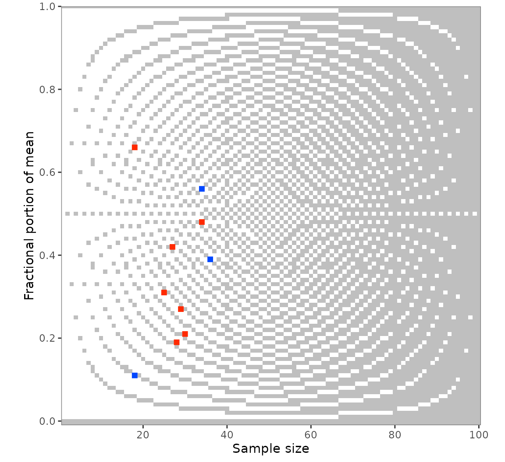
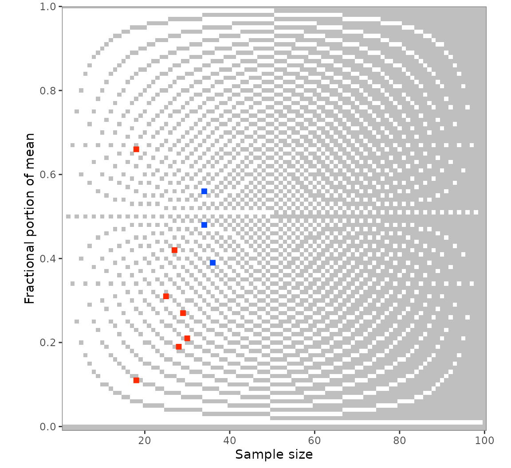

# GRIM basics

Granularity-related inconsistency of means, or GRIM, tests whether a
reported mean or percentage of integer data is possible given the
reported sample size (Brown and Heathers 2017). The mean of $`n`$
integers is a whole number divided by $`n`$, so only certain values can
occur. If none of these values would have been reported as the reported
mean, given its number of decimal places, the mean and the sample size
are GRIM-inconsistent.

This vignette covers the basics:
[`grim()`](https://lhdjung.github.io/scrutiny/reference/grim.md) and
[`grim_map()`](https://lhdjung.github.io/scrutiny/reference/grim_map.md)
for the test itself,
[`explain_print()`](https://lhdjung.github.io/scrutiny/reference/explain_print.md)
to explain a result,
[`audit()`](https://lhdjung.github.io/scrutiny/reference/audit.md) for
summaries, and
[`grim_plot_grid()`](https://lhdjung.github.io/scrutiny/reference/grim_plot_grid.md)
for visualization.
[`vignette("grim-in-depth")`](https://lhdjung.github.io/scrutiny/articles/grim-in-depth.md)
goes further.

### Basic GRIM testing

#### Single cases: `grim()`

To test whether a mean of 5.27 is consistent with a sample size of 43:

``` r

grim(x = 5.27, n = 43, digits_x = 2, items_averaged = 1, data_type = "integer")
#> [1] FALSE
```

`digits_x` is the number of decimal places the mean was reported with.
It cannot be inferred from the value, because a mean reported as 5.30 is
stored as `5.3`.

`items_averaged` is the number of items averaged into each respondent’s
score. Use 1 for a single item or for the percentage of participants
with some answer; see *Scale items* and *Percentages* below.

`data_type` says what kind of data the mean summarizes. GRIM only
applies to whole numbers:

- `"integer"`: whole numbers, such as answers on a rating scale or
  counts.
- `"continuous"`: anything else, such as reaction times or body mass
  index. Any mean is possible, so the result is `TRUE`.

None of these arguments has a default, since the result depends on all
of them.

By default,
[`grim()`](https://lhdjung.github.io/scrutiny/reference/grim.md) accepts
a mean whether a tie was rounded up or down (`rounding = "up_or_down"`).
Reports rarely say how they rounded, and the common methods only
disagree on ties: SPSS and Excel round a 5 away from zero, R and Python
round it to an even digit. A mean that fails under the default is
inconsistent under all of them. See *Defaults* in
[`?grim`](https://lhdjung.github.io/scrutiny/reference/grim.md).

[`grim()`](https://lhdjung.github.io/scrutiny/reference/grim.md) is
vectorized, but for more than a few cases,
[`grim_map()`](https://lhdjung.github.io/scrutiny/reference/grim_map.md)
is more convenient.

#### Many cases: `grim_map()`

Enter the reported values into a data frame and call
[`grim_map()`](https://lhdjung.github.io/scrutiny/reference/grim_map.md)
on it. One way to enter them is to copy a column from a PDF and paste it
into
[`tibble::tribble()`](https://tibble.tidyverse.org/reference/tribble.html);
see
[`vignette("wrangling")`](https://lhdjung.github.io/scrutiny/articles/wrangling.md).

``` r

flying_pigs1 <- tibble::tribble(
  ~x    ,
   8.97 ,
   2.61 ,
   7.26 ,
   3.64 ,
   9.26 ,
  10.46 ,
   7.39
) |>
  dplyr::mutate(n = 28)

grim_map(flying_pigs1, digits_x = 2, items_averaged = 1, data_type = "integer")
#> # A tibble: 7 × 7
#> # GRIM: default settings
#>       x     n items_averaged data_type digits_x consistency exp_incon
#>   <dbl> <int>          <int> <chr>        <int> <lgl>           <dbl>
#> 1  8.97    28              1 integer          2 FALSE            0.72
#> 2  2.61    28              1 integer          2 TRUE             0.72
#> 3  7.26    28              1 integer          2 FALSE            0.72
#> 4  3.64    28              1 integer          2 TRUE             0.72
#> 5  9.26    28              1 integer          2 FALSE            0.72
#> 6 10.46    28              1 integer          2 TRUE             0.72
#> 7  7.39    28              1 integer          2 TRUE             0.72
```

`x` and `n` are the inputs, `digits_x` is the stated number of decimal
places, and `consistency` is the test result. `exp_incon` is the
probability that a random mean with that many decimal places would be
inconsistent with `n`; see *GRIM statistics* in
[`vignette("grim-in-depth")`](https://lhdjung.github.io/scrutiny/articles/grim-in-depth.md).

The line above the column names lists any settings that differ from
their defaults, such as `rounding = "up"`. Here, there are none.

#### Scale items

If a mean is the average of several items, it is a multiple of
$`1 / (n \cdot \text{items})`$ rather than of $`1 / n`$. Give the number
of items, not of scale points, as `items_averaged`: a mean over three
7-point items has `items_averaged = 3`. Taken as single items, half of
these means from a three-item scale are wrongly flagged:

``` r

scale_means <- tibble::tribble(
  ~x   ,
  5.90 ,
  5.71 ,
  3.50 ,
  3.82 ,
  4.61 ,
  5.24 ,
) |>
  dplyr::mutate(n = 40)

scale_means |>
  grim_map(digits_x = 2, items_averaged = 1, data_type = "integer")
#> # A tibble: 6 × 7
#> # GRIM: default settings
#>       x     n items_averaged data_type digits_x consistency exp_incon
#>   <dbl> <int>          <int> <chr>        <int> <lgl>           <dbl>
#> 1  5.9     40              1 integer          2 TRUE              0.4
#> 2  5.71    40              1 integer          2 FALSE             0.4
#> 3  3.5     40              1 integer          2 TRUE              0.4
#> 4  3.82    40              1 integer          2 TRUE              0.4
#> 5  4.61    40              1 integer          2 FALSE             0.4
#> 6  5.24    40              1 integer          2 FALSE             0.4

scale_means |>
  grim_map(digits_x = 2, items_averaged = 3, data_type = "integer")
#> # A tibble: 6 × 7
#> # GRIM: default settings
#>       x     n items_averaged data_type digits_x consistency exp_incon
#>   <dbl> <int>          <int> <chr>        <int> <lgl>           <dbl>
#> 1  5.9     40              3 integer          2 TRUE                0
#> 2  5.71    40              3 integer          2 TRUE                0
#> 3  3.5     40              3 integer          2 TRUE                0
#> 4  3.82    40              3 integer          2 TRUE                0
#> 5  4.61    40              3 integer          2 TRUE                0
#> 6  5.24    40              3 integer          2 TRUE                0
```

An `items_averaged` column of `data` lets the number vary by row:

``` r

mixed_scales <- tibble::tribble(
  ~x   , ~items_averaged ,
  6.92 ,               1 ,
  3.48 ,               1 ,
  1.59 ,               2 ,
  2.61 ,               2 ,
  4.04 ,               3 ,
  4.50 ,               3 ,
) |>
  dplyr::mutate(n = 30)

mixed_scales |>
  grim_map(digits_x = 2, data_type = "integer")
#> # A tibble: 6 × 7
#> # GRIM: default settings
#>       x     n items_averaged data_type digits_x consistency exp_incon
#>   <dbl> <int>          <int> <chr>        <int> <lgl>           <dbl>
#> 1  6.92    30              1 integer          2 FALSE             0.7
#> 2  3.48    30              1 integer          2 FALSE             0.7
#> 3  1.59    30              2 integer          2 FALSE             0.4
#> 4  2.61    30              2 integer          2 FALSE             0.4
#> 5  4.04    30              3 integer          2 TRUE              0.1
#> 6  4.5     30              3 integer          2 TRUE              0.1
```

#### Percentages

A percentage with one decimal place is a proportion with three.
`x_meaning = "percentage"` divides `x` by 100 and adds 2 to `digits_x`,
so these percentages are tested as proportions with three decimal
places:

``` r

percentages <- tibble::tribble(
  ~x   , ~n  ,
  32.5 , 438 ,
  35.6 , 455 ,
  21.7 , 501 ,
  39.3 , 516 ,
)

percentages |>
  grim_map(digits_x = 1, items_averaged = 1, data_type = "integer", x_meaning = "percentage")
#> # A tibble: 4 × 7
#> # GRIM: x_meaning = "percentage"
#>       x     n items_averaged data_type digits_x consistency exp_incon
#>   <dbl> <int>          <int> <chr>        <int> <lgl>           <dbl>
#> 1  32.5   438              1 integer          1 FALSE           0.562
#> 2  35.6   455              1 integer          1 TRUE            0.545
#> 3  21.7   501              1 integer          1 FALSE           0.499
#> 4  39.3   516              1 integer          1 TRUE            0.484
```

GRIM is therefore much more powerful for percentages than for means with
the same number of decimal places.

A percentage can average several items, too: the mean percent correct on
a test of `k` questions is a multiple of $`1 / (n \cdot k)`$, as is a
pooled proportion of successes over `k` trials per participant. Set
`items_averaged = k` in such cases.

### Explaining consistency results

[`explain_print()`](https://lhdjung.github.io/scrutiny/reference/explain_print.md)
explains the results of
[`grim_map()`](https://lhdjung.github.io/scrutiny/reference/grim_map.md)
in plain words, with every number needed to check them by hand. It picks
rows like
[`dplyr::slice()`](https://dplyr.tidyverse.org/reference/slice.html), so
this explains the first inconsistent value set:

``` r

flying_pigs1 |>
  grim_map(digits_x = 2, items_averaged = 1, data_type = "integer") |>
  dplyr::filter(!consistency) |>
  explain_print(1)
#> GRIM test: x = 8.97, n = 28, items_averaged = 1, data_type = "integer"
#> 
#> The mean was reported as 8.97, with 2 decimal places. Before rounding (assuming
#> either rounding up from 5 or down from 5), it could have been anything from
#> 8.965 to 8.975.
#> 
#> The mean of 28 integers is their sum divided by 28. So the sum must be from
#> 8.965 * 28 = 251.02 to 8.975 * 28 = 251.3.
#> 
#> A sum of integers is itself an integer, but there is no integer in this range.
#> The nearest ones are 251 and 252. They give 251 / 28 = 8.9643 and 252 / 28 = 9,
#> which round to 8.96 and 9.00, not to 8.97.
#> 
#> ==> Inconsistent
```

[`explain_map()`](https://lhdjung.github.io/scrutiny/reference/explain_map.md)
adds the explanations to the data frame as an `explanation` column
instead, e.g., to save them with the results. Both test each row again
with the settings of the
[`grim_map()`](https://lhdjung.github.io/scrutiny/reference/grim_map.md)
call, such as `rounding`, and throw an error if a result differs from
the `consistency` column. For a single value set, use
[`grim_explain()`](https://lhdjung.github.io/scrutiny/reference/grim_explain.md),
which takes the same arguments as
[`grim()`](https://lhdjung.github.io/scrutiny/reference/grim.md).

To see the test rather than read it, draw one value set with
[`grim_plot_line()`](https://lhdjung.github.io/scrutiny/reference/grim_plot_line.md);
see
[`vignette("grim-in-depth")`](https://lhdjung.github.io/scrutiny/articles/grim-in-depth.md).

### Summaries with `audit()`

[`audit()`](https://lhdjung.github.io/scrutiny/reference/audit.md)
summarizes the output of
[`grim_map()`](https://lhdjung.github.io/scrutiny/reference/grim_map.md):

``` r

flying_pigs1 |>
  grim_map(digits_x = 2, items_averaged = 1, data_type = "integer") |>
  audit()
#> # A tibble: 1 × 6
#>   all_cases testable_cases incon_cases emp_incon exp_incon  ratio
#>       <int>          <int>       <int>     <dbl>     <dbl>  <dbl>
#> 1         7              7           3    0.4286      0.72 0.5952
```

- `all_cases`, `testable_cases`: the number of value sets, and of those
  with a positive `exp_incon`.
- `incon_cases`, `emp_incon`: the number and proportion of inconsistent
  value sets.
- `exp_incon`: the mean probability of GRIM inconsistency.
- `ratio`: the ratio of `emp_incon` to `exp_incon`, computed over the
  cases with a test result.

If the value sets come from several studies or tables, `.by` summarizes
each one separately:

``` r

flying_pigs1 |>
  dplyr::mutate(study = c("A", "A", "A", "B", "B", "B", "B")) |>
  grim_map(digits_x = 2, items_averaged = 1, data_type = "integer") |>
  audit(.by = study)
#> # A tibble: 2 × 7
#>   study all_cases testable_cases incon_cases emp_incon exp_incon  ratio
#>   <chr>     <int>          <int>       <int>     <dbl>     <dbl>  <dbl>
#> 1 A             3              3           2    0.6667      0.72 0.9259
#> 2 B             4              4           1    0.25        0.72 0.3472
```

Columns that play no role in the test, such as `study` here, are kept to
the right of `consistency`.

### Visualization with `grim_plot_grid()`

[`grim_plot_grid()`](https://lhdjung.github.io/scrutiny/reference/grim_plot_grid.md)
takes the output of
[`grim_map()`](https://lhdjung.github.io/scrutiny/reference/grim_map.md):

``` r

many_means <- tibble::tribble(
  ~x   , ~n ,
  7.19 , 28 ,
  4.56 , 34 ,
  0.42 , 27 ,
  1.31 , 25 ,
  3.48 , 34 ,
  4.27 , 29 ,
  6.21 , 30 ,
  3.11 , 18 ,
  5.39 , 36 ,
  5.66 , 18 ,
)

many_means |>
  grim_map(digits_x = 2, items_averaged = 1, data_type = "integer") |>
  grim_plot_grid()
```



Each value set is plotted at its sample size (x-axis) and the fractional
part of its mean (y-axis), in blue if consistent and red if not. The
background raster shows, for every combination of sample size and
fractional part, whether it is GRIM-consistent (grey) or not (white). It
depends on the number of decimal places, which
[`grim_plot_grid()`](https://lhdjung.github.io/scrutiny/reference/grim_plot_grid.md)
reads from the `digits_x` column, and on the rounding method, which the
mapper recorded in its output:

``` r

many_means |>
  grim_map(digits_x = 2, items_averaged = 1, data_type = "integer", rounding = "ceiling") |>
  grim_plot_grid()
```



In the first plot, the grey vertical line at $`n = 80`$, and the one at
$`n = 40`$, which is grey in 60% of the cells rather than about 40% as
its neighbors, come from the default `rounding = "up_or_down"`: many
achievable means at these sample sizes lie exactly halfway between two
reportable values, and the default accepts both ways of rounding them.
With three or more decimal places, a gradient is shown instead of a
raster.

[`grim_plot_grid()`](https://lhdjung.github.io/scrutiny/reference/grim_plot_grid.md)
takes the output of any GRIM or GRIMMER mapper, such as
[`grim_map()`](https://lhdjung.github.io/scrutiny/reference/grim_map.md)
or
[`grim_map_seq()`](https://lhdjung.github.io/scrutiny/reference/grim_map_seq.md).

### Interpreting results

An inconsistency means that an assumption of the test is false or that a
number was reported incorrectly, often for a benign reason. What to rule
out before drawing conclusions is discussed in [the section on
interpreting GRIM
results](https://trustworthyresear.ch/chapters/granularity_methods.html#sec-grim-interpreting)
of Hussey (2026).

### Going further

[`vignette("grim-in-depth")`](https://lhdjung.github.io/scrutiny/articles/grim-in-depth.md)
shows the numbers behind a result, tests values around the reported ones
with
[`grim_map_seq()`](https://lhdjung.github.io/scrutiny/reference/grim_map_seq.md)
and unknown group sizes with
[`grim_map_total_n()`](https://lhdjung.github.io/scrutiny/reference/grim_map_total_n.md),
and covers the GRIM statistics.

## References

Brown, Nicholas J. L., and James A. J. Heathers. 2017. “The GRIM Test: A
Simple Technique Detects Numerous Anomalies in the Reporting of Results
in Psychology.” *Social Psychological and Personality Science* 8 (4):
363–69.

Hussey, Ian. 2026. *Trustworthiness Assessment and Forensic
Meta-Science*. <https://doi.org/10.5281/zenodo.23056120>.
