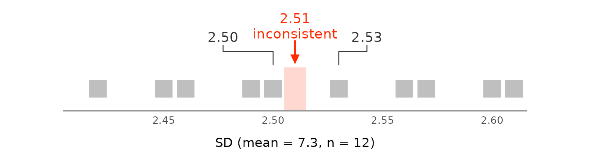
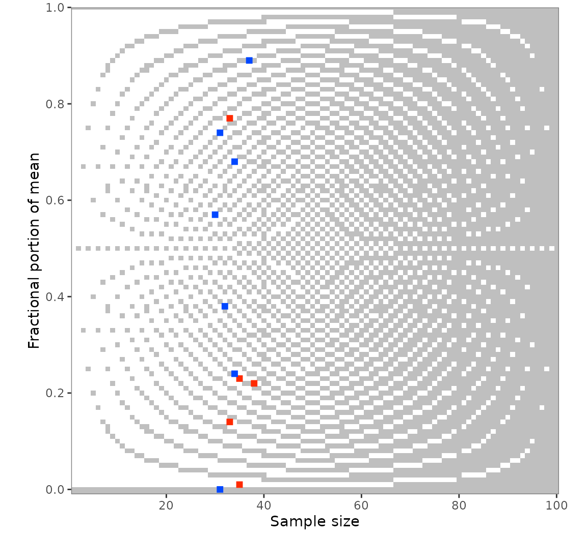
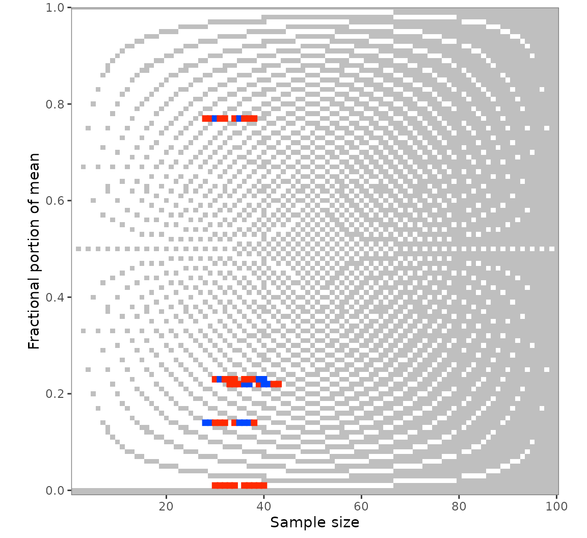

# GRIMMER in depth

This vignette builds on
[`vignette("grimmer")`](https://lhdjung.github.io/scrutiny/articles/grimmer.md),
which covers the basics of GRIMMER testing with
[`grimmer()`](https://lhdjung.github.io/scrutiny/reference/grimmer.md)
and
[`grimmer_map()`](https://lhdjung.github.io/scrutiny/reference/grimmer_map.md).
Here are SDs computed by other conventions, bounded scales, the means
and SDs behind a test result, plots, and the values around the reported
ones with
[`grimmer_map_seq()`](https://lhdjung.github.io/scrutiny/reference/grimmer_map_seq.md)
and
[`grimmer_map_total_n()`](https://lhdjung.github.io/scrutiny/reference/grimmer_map_total_n.md).
The last few work like their GRIM counterparts in
[`vignette("grim-in-depth")`](https://lhdjung.github.io/scrutiny/articles/grim-in-depth.md).

## Sample or population SD

GRIMMER takes the SD to be a sample SD, which divides by $`n - 1`$. A
population SD, as from NumPy’s `np.std()` or Excel’s `STDEV.P`, divides
by $`n`$. At small $`n`$, such an SD often fails the test as a sample
SD. The values 2, 4, 4, 5, and 7 have a mean of 4.4 and a population SD
of 1.62:

``` r

grimmer(
  x = 4.4,
  sd = 1.62,
  n = 5,
  digits_x = 1,
  digits_sd = 2,
  items_averaged = 1,
  data_type = "integer"
)
#> [1] FALSE
grimmer(
  x = 4.4,
  sd = 1.62,
  n = 5,
  digits_x = 1,
  digits_sd = 2,
  items_averaged = 1,
  data_type = "integer",
  sd_meaning = "sd_pop"
)
#> [1] TRUE
```

`sd_meaning = "sd_sample_or_pop"` accepts a value set that is consistent
under either convention, and the `reason` column of
[`grimmer_map()`](https://lhdjung.github.io/scrutiny/reference/grimmer_map.md)
says which one. It accepts more SDs than either convention alone, and a
study has most likely computed all its SDs the same way, so testing
under `"sd_sample"` and `"sd_pop"` separately tells you more.

`sd_meaning = "se"` tests whether a standard error was reported as an
SD. This test is weak: the SE was rounded, so the SD may lie in a range
`sqrt(n)` times as wide. Beyond very small samples, nearly every value
set passes, so a consistent result under `"se"` is no evidence that an
SE was reported.

## Bounded scales

GRIMMER does not use the bounds of a scale. For data on a bounded scale,
such as a five-point Likert scale, see the
[strait](https://github.com/ianhussey/strait) package, whose
`brimmest()` decides exactly whether a mean and SD are possible within
the bounds.

## Achievable means and SDs

[`grimmer_values()`](https://lhdjung.github.io/scrutiny/reference/grimmer_values.md)
returns every pair of a mean and an SD that a sample of `n` integers can
have and that would be reported as `x` and `sd`, with the sum and sum of
squares behind each. It is the counterpart of
[`grim_values()`](https://lhdjung.github.io/scrutiny/reference/grim_values.md),
and like it, it returns one row per achievable pair, with `case` for the
value set, and none if the value set is inconsistent:

``` r

grimmer_values(
  x = 5.3,
  sd = 0.7,
  n = 30,
  digits_x = 1,
  digits_sd = 1,
  items_averaged = 1,
  data_type = "integer"
)
#> # A tibble: 7 × 7
#>    case     x     sd     n items_averaged   sum sum_squares
#>   <int> <dbl>  <dbl> <int>          <int> <dbl>       <dbl>
#> 1     1 5.267 0.6915    30              1   158         846
#> 2     1 5.267 0.7397    30              1   158         848
#> 3     1 5.3   0.6513    30              1   159         855
#> 4     1 5.3   0.7022    30              1   159         857
#> 5     1 5.3   0.7497    30              1   159         859
#> 6     1 5.333 0.6609    30              1   160         866
#> 7     1 5.333 0.7112    30              1   160         868
grimmer_values(
  x = 5.23,
  sd = 2.55,
  n = 35,
  digits_x = 2,
  digits_sd = 2,
  items_averaged = 1,
  data_type = "integer"
)
#> # A tibble: 0 × 7
#> # ℹ 7 variables: case <int>, x <dbl>, sd <dbl>, n <int>, items_averaged <int>,
#> #   sum <dbl>, sum_squares <dbl>
```

With the sum and sum of squares of each group, a statistic that combines
several groups, such as a *t*-value, can be recomputed for every
possible sample and compared with the reported one.
`sd_meaning = "sd_sample_or_pop"` is not allowed here: the same sum of
squares gives a different SD under each premise, so call the function
once for each.

[`grimmer_closest()`](https://lhdjung.github.io/scrutiny/reference/grimmer_values.md)
returns the one pair whose SD is closest to the reported one, like
[`grim_closest()`](https://lhdjung.github.io/scrutiny/reference/grim_values.md)
for means. For an inconsistent value set, this shows how far off the SD
is:

``` r

grimmer_closest(
  x = 5.23,
  sd = 2.55,
  n = 35,
  digits_x = 2,
  digits_sd = 2,
  items_averaged = 1,
  data_type = "integer"
)
#> # A tibble: 1 × 7
#>    case     x    sd     n items_averaged   sum sum_squares
#>   <int> <dbl> <dbl> <int>          <int> <dbl>       <dbl>
#> 1     1 5.229 2.545    35              1   183        1177
```

## A single value set: `grimmer_plot_line()`

[`grimmer_plot_line()`](https://lhdjung.github.io/scrutiny/reference/grimmer_plot_line.md)
draws the test for a single value set, like
[`grim_plot_line()`](https://lhdjung.github.io/scrutiny/reference/grim_plot_line.md)
does for means; it helps to explain a result. It shows the SDs that
could have been reported around the reported one and marks those that a
sample with the given mean and size can have:

``` r

grimmer_plot_line(
  x = 7.3,
  sd = 2.51,
  n = 12,
  digits_x = 1,
  digits_sd = 2,
  items_averaged = 1,
  data_type = "integer"
)
```



## Many value sets: `grim_plot_grid()`

[`grim_plot_grid()`](https://lhdjung.github.io/scrutiny/reference/grim_plot_grid.md)
accepts
[`grimmer_map()`](https://lhdjung.github.io/scrutiny/reference/grimmer_map.md)
output. The raster shows the GRIM part of the test, and each value set
is colored by its GRIMMER result. A red value set on a grey cell passed
GRIM but failed GRIMMER, and a message counts these:

``` r

pigs5 |>
  grimmer_map(digits_x = 2, digits_sd = 2, items_averaged = 1, data_type = "integer") |>
  grim_plot_grid()
#> → Also visualizing 1 GRIMMER inconsistency.
```



## Values around the reported ones: `grimmer_map_seq()`

[`grimmer_map_seq()`](https://lhdjung.github.io/scrutiny/reference/grimmer_map_seq.md)
varies `x`, `sd`, and `n` around the reported values, by default only
for inconsistent value sets:

``` r

out_seq1 <- grimmer_map_seq(
  pigs5,
  digits_x = 2,
  digits_sd = 2,
  items_averaged = 1,
  data_type = "integer"
)
out_seq1
#> # A tibble: 150 × 12
#> # GRIMMER: default settings
#>        x    sd     n items_averaged data_type digits_x digits_sd consistency
#>    <dbl> <dbl> <int>          <int> <chr>        <int>     <int> <lgl>      
#>  1  7.17   5.3    38              1 integer          2         2 FALSE      
#>  2  7.18   5.3    38              1 integer          2         2 TRUE       
#>  3  7.19   5.3    38              1 integer          2         2 FALSE      
#>  4  7.2    5.3    38              1 integer          2         2 FALSE      
#>  5  7.21   5.3    38              1 integer          2         2 TRUE       
#>  6  7.23   5.3    38              1 integer          2         2 FALSE      
#>  7  7.24   5.3    38              1 integer          2         2 TRUE       
#>  8  7.25   5.3    38              1 integer          2         2 FALSE      
#>  9  7.26   5.3    38              1 integer          2         2 TRUE       
#> 10  7.27   5.3    38              1 integer          2         2 FALSE      
#> # ℹ 140 more rows
#> # ℹ 4 more variables: reason <chr>, diff_var <int>, case <int>, var <chr>

audit(out_seq1)
#> # A tibble: 5 × 19
#>       x    sd     n items_averaged data_type consistency hits_total hits_x
#>   <dbl> <dbl> <int>          <int> <chr>     <lgl>            <int>  <int>
#> 1  7.22  5.3     38              1 integer   FALSE                8      4
#> 2  5.23  2.55    35              1 integer   FALSE               15      2
#> 3  6.77  2.18    33              1 integer   FALSE                5      3
#> 4  7.01  6.68    35              1 integer   FALSE                4      4
#> 5  3.14  5.32    33              1 integer   FALSE                9      4
#> # ℹ 11 more variables: hits_sd <int>, hits_n <int>, diff_x <int>,
#> #   diff_x_up <int>, diff_x_down <int>, diff_sd <int>, diff_sd_up <int>,
#> #   diff_sd_down <int>, diff_n <int>, diff_n_up <int>, diff_n_down <int>
```

The summary is the same as for GRIM, with `hits_sd` and the `diff_sd*`
columns added. More steps typically find more hits:

``` r

out_seq2 <- grimmer_map_seq(
  pigs5,
  digits_x = 2,
  digits_sd = 2,
  items_averaged = 1,
  data_type = "integer",
  dispersion = 1:10
)
audit(out_seq2)
#> # A tibble: 5 × 19
#>       x    sd     n items_averaged data_type consistency hits_total hits_x
#>   <dbl> <dbl> <int>          <int> <chr>     <lgl>            <int>  <int>
#> 1  7.22  5.3     38              1 integer   FALSE               15      8
#> 2  5.23  2.55    35              1 integer   FALSE               30      6
#> 3  6.77  2.18    33              1 integer   FALSE               10      4
#> 4  7.01  6.68    35              1 integer   FALSE                8      8
#> 5  3.14  5.32    33              1 integer   FALSE               14      7
#> # ℹ 11 more variables: hits_sd <int>, hits_n <int>, diff_x <int>,
#> #   diff_x_up <int>, diff_x_down <int>, diff_sd <int>, diff_sd_up <int>,
#> #   diff_sd_down <int>, diff_n <int>, diff_n_up <int>, diff_n_down <int>
```

[`grim_plot_grid()`](https://lhdjung.github.io/scrutiny/reference/grim_plot_grid.md)
accepts this output as well, and `var` restricts the dispersion to one
variable:

``` r

out_seq1_only_n <- grimmer_map_seq(
  pigs5,
  digits_x = 2,
  digits_sd = 2,
  items_averaged = 1,
  data_type = "integer",
  var = "n"
)
grim_plot_grid(out_seq1_only_n)
#> → Also visualizing 2 GRIMMER inconsistencies.
```



## Unknown group sizes: `grimmer_map_total_n()`

If only the total sample size of two groups is known,
[`grimmer_map_total_n()`](https://lhdjung.github.io/scrutiny/reference/grimmer_map_total_n.md)
tests hypothetical splits of it, as
[`grim_map_total_n()`](https://lhdjung.github.io/scrutiny/reference/grim_map_total_n.md)
does; see
[`vignette("grim-in-depth")`](https://lhdjung.github.io/scrutiny/articles/grim-in-depth.md)
for a case study.

``` r

flying_pigs4 <- tibble::tribble(
  ~x1  , ~x2  , ~sd1 , ~sd2 , ~n ,
  3.91 , 3.89 , 1.38 , 1.47 , 70 ,
  3.77 , 4.37 , 1.74 , 1.44 , 65
)

out_total_n <- grimmer_map_total_n(
  flying_pigs4,
  digits_x = 2,
  digits_sd = 2,
  items_averaged = 1,
  data_type = "integer"
)
out_total_n
#> # A tibble: 46 × 13
#> # GRIMMER: default settings
#>        x    sd     n n_change items_averaged data_type digits_x digits_sd
#>    <dbl> <dbl> <int>    <int>          <int> <chr>        <int>     <int>
#>  1  3.91  1.38    35        0              1 integer          2         2
#>  2  3.89  1.47    35        0              1 integer          2         2
#>  3  3.91  1.38    34       -1              1 integer          2         2
#>  4  3.89  1.47    36        1              1 integer          2         2
#>  5  3.91  1.38    33       -2              1 integer          2         2
#>  6  3.89  1.47    37        2              1 integer          2         2
#>  7  3.91  1.38    32       -3              1 integer          2         2
#>  8  3.89  1.47    38        3              1 integer          2         2
#>  9  3.91  1.38    31       -4              1 integer          2         2
#> 10  3.89  1.47    39        4              1 integer          2         2
#> # ℹ 36 more rows
#> # ℹ 5 more variables: consistency <lgl>, both_consistent <lgl>, reason <chr>,
#> #   case <int>, dir <fct>

audit(out_total_n)
#> # A tibble: 2 × 10
#>      x1    x2   sd1   sd2     n hits_total hits_forth hits_back scenarios_total
#>   <dbl> <dbl> <dbl> <dbl> <int>      <int>      <int>     <int>           <int>
#> 1  3.91  3.89  1.38  1.47    70          4          4         0              11
#> 2  3.77  4.37  1.74  1.44    65          1          1         0              12
#> # ℹ 1 more variable: hit_rate <dbl>
```
