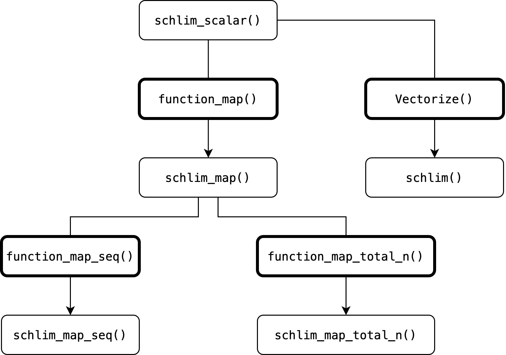

```{r, include = FALSE}
knitr::opts_chunk$set(
  collapse = TRUE,
  comment = "#>"
)
# Print enough significant digits that values like `10.46` are not
# abbreviated to `10.5` in the output tibbles:
options(pillar.sigfig = 4)
```

```{r setup, include = FALSE}
library(scrutiny)
```

# Introduction

This vignette describes scrutiny's infrastructure for implementing new consistency tests. For a short version, see `vignette("consistency-tests-simple")`.

A consistency test is implemented at several levels, most of them created from the previous one by a function factory. Since the factories work the same way for every test, all test functions share one interface: anyone who knows the `grim_*()` functions can use the `grimmer_*()` functions as well.

These are the levels, with GRIM as the example. If you implement a valid consistency test at least at the first level, I'll be happy to accept a pull request to scrutiny.

1.  A non-exported function that tests a single case, such as `grim_scalar()`.

2.  A vectorized version of it, such as `grim()`.

3.  A mapper that applies the single-case function to each row of a data frame, such as `grim_map()`.

4.  An `audit()` method that summarizes the output of number 3, and an `explain_map()` method that explains it.

5.  A function that plots the output of number 3, such as `grim_plot_grid()`.

6.  A sequence mapper that tests slightly varied input values, such as `grim_map_seq()`.

7.  A total-n mapper for studies with two groups that only report the total sample size, such as `grim_map_total_n()`.

The examples use a mock test called SCHLIM, which has no meaning in itself. A real implementation will usually be more complex than the snippets below.

Please follow the [tidyverse style guide](https://style.tidyverse.org/) and the conventions below. To write a new package, see [*R Packages*](https://r-pkgs.org/) [@wickham2023].

# 1. Single-case

This function contains the test itself. It is not exported, but every other level builds on it.

It takes one value for each statistic that is tested for consistency with the others. It returns `TRUE` if they are consistent, `FALSE` if they aren't, and `NA` if the case can't be decided, as with a missing value. In scrutiny's own tests, a missing value only makes the result `NA` if some value in its place would make the case consistent and another would not; see *Missing values* in `vignette("technical-notes")`.

```{r}
schlim_scalar <- function(y, n) {
  (y / 3) > n
}

schlim_scalar(y = 30, n = 4)
schlim_scalar(y = 2, n = 7)
```

If the test reconstructs rounded numbers, give the function a `rounding` argument with the default `"up_or_down"`, and pass it on to `roundwork::reround()` or `roundwork::unround()`; see `vignette("rounding-in-depth", package = "roundwork")`. To compare the range of a rounded value with whole numbers, as GRIM does, use `roundwork::bound_numerators()` or `roundwork::sum_range()`, which keep the comparison exact; see *Exact arithmetic* in `vignette("technical-notes")`. Take the number of decimal places as an argument without a default, like `digits_x` in `grim()`, rather than counting them: a numeric value has lost any trailing zeros.

Name the function after the test in lowercase, followed by `_scalar`. If R's own vectorization already makes it work on vectors in every argument, leave out `_scalar`, export it, and skip section 2.

Exported scrutiny functions often call internal helpers, most of which are documented in [utils.R](https://github.com/lhdjung/scrutiny/blob/main/R/utils.R). To reuse one, copy its source code, which `scrutiny:::helper_name` (without parentheses) prints. Don't call it with `:::` in your code: internals can change or vanish without notice. See [this blogpost](https://tidyverse.org/blog/2022/09/playing-on-the-same-team-as-your-dependecy/) by Thomas Lin Pedersen.

# 2. Vectorized

The simplest way to vectorize the single-case function is `Vectorize()`. The result is named after the test:

```{r}
schlim <- Vectorize(schlim_scalar)

schlim(y = 10:15, n = 4)
```

`Vectorize()` loops over every argument. This is wrong for two kinds of arguments: those that only the mapper should set, such as `show_rec` in `grim_scalar()`, which makes the function return a list; and those that describe the test as a whole, such as `rounding`. This is why `grim()`, `grimmer()`, and `debit()` have handwritten signatures instead. If your single-case function has such arguments, do the same: loop over the reported values only, and pass the other arguments on as they are. Suppose `schlim_scalar()` took a `rounding` argument:

```{r, eval=FALSE}
schlim <- function(y, n, rounding = "up_or_down") {
  purrr::map2_lgl(y, n, schlim_scalar, rounding = rounding)
}
```

`purrr::map2_lgl()` recycles only values of length 1, so `y` and `n` must otherwise have the same length. Use `purrr::pmap_lgl()` for three or more reported values.

The rest of the vignette builds on the mapper, not on the vectorized function.

# 3. Basic mapper

## Creating basic mappers with `function_map()`

A mapper applies the test to every row of a data frame, as `grim_map()` does. Every function in the rest of the vignette builds on it. It accepts any data frame and returns a [tibble](https://tibble.tidyverse.org/).

Create mappers with `function_map()`:

```{r}
schlim_map <- function_map(
  .fn = schlim_scalar,
  .reported = c("y", "n"),
  .name_test = "SCHLIM"
)

# Example data:
df1 <- tibble::tibble(y = 16:25, n = 3:12)

schlim_map(df1)
```

These arguments are required:

-   `.fn` is the single-case function from section 1.

-   `.reported` names the arguments of `.fn` that take the reported statistics. These become the key columns. `function_map()` does not assume any particular number of them: GRIM has two, GRIMMER and DEBIT have three.

-   `.name_test` is the name of the test, used in messages and in the class of the output.

Every other argument of `.fn` becomes an argument of the mapper, with the same default. Optional arguments of `function_map()` control how some of them are treated:

| Argument | Purpose | Example in scrutiny |
|:---|:---|:---|
| `.args_by_row` | Arguments that take one value per row, returned as columns | `digits_x` |
| `.cols_helper` | Arguments that may also be columns of `data`, returned after the key columns if given | `items_averaged` |
| `.args_fixed` | Values always passed to `.fn`; the mapper has no argument for them | `list(show_reason = TRUE)` in `grimmer_map()` |
| `.args_disabled` | Arguments of `.fn` that the mapper should not have | |
| `.col_names` | Names of the columns that a list returned by `.fn` unpacks into; the first is the key result | `show_rec = TRUE` columns |
| `.cols_derived` | Vectorized functions that compute further columns from the same columns | `list(exp_incon = grim_exp_incon)` |
| `.name_class` | Extra classes for the output | |
| `.name_key_result` | Name of the result column, `"consistency"` by default | |

`grim_map()` itself is made this way:

```{r, eval=FALSE}
grim_map <- function_map(
  .fn = grim_scalar,
  .reported = c("x", "n"),
  .name_test = "GRIM",
  .args_by_row = "digits_x",
  .cols_helper = c("items_averaged", "data_type"),
  .col_names = c(
    "consistency",
    "rec_sum",
    "sum_lower",
    "sum_upper",
    "rec_x_upper",
    "rec_x_lower"
  ),
  # Not returned by `grim_scalar()`, which would change what `grim()` returns:
  .cols_derived = list(exp_incon = grim_exp_incon)
)
```

The output has the key columns first, then any helper columns that were given, any columns of `.args_by_row` arguments, and `consistency`. Other columns of `data` follow it. Functions built on the mapper, such as `function_map_seq()`, read the columns left of `consistency` as the input to the test. The arguments of a call that apply to all rows, such as `rounding`, are recorded on the output; see `scrutiny_meta()`.

### Context and export

`function_map()` takes the place of `function()`: it is a function factory, or more precisely a [function operator](https://adv-r.hadley.nz/function-operators.html) [@wickham2019], like `Vectorize()`.

To export a function made this way from your own package, follow [this purrr FAQ](https://purrr.tidyverse.org/reference/faq-adverbs-export.html), with scrutiny in the role of purrr:

``` r
schlim_map <- function(...) "dummy"

.onLoad <- function(lib, pkg) {
  schlim_map <<- scrutiny::function_map(
    .fn = schlim_scalar,
    .reported = c("y", "n"),
    .name_test = "SCHLIM"
  )
}
```

### Identifying columns

Factory-made functions have one argument for each `.reported` value. If the columns of `data` have other names, specify these names via the arguments:

```{r}
df2 <- df1
names(df2) <- c("foo", "bar")

schlim_map(df2, y = foo, n = bar)
```

A key column that is neither present in `data` nor identified via an argument is an error:

```{r, error=TRUE}
schlim_map(df2, y = foo)

# With a wrong identification:
schlim_map(df2, n = mike)
```

### A variable number of key columns

Some tests don't have a fixed set of key columns. Think of a test that checks whether the values in any number of columns add up to the value in another column: how many columns go into each check depends on the data, not on the test.

Write the `*_scalar()` function so that it takes those values as a single vector argument, and name that argument in `.reported_variadic`:

```{r}
sum_check_scalar <- function(parts, total, tolerance = 0) {
  abs(sum(parts) - total) <= tolerance
}

sum_check_map <- function_map(
  .fn = sum_check_scalar,
  .reported = "total",
  .reported_variadic = "parts",
  .name_test = "SUMCHECK"
)
```

The mapper then has a `parts` argument that selects columns using [tidyselect](https://tidyselect.r-lib.org/) syntax, alongside the ordinary `total` key argument:

```{r}
df3 <- tibble::tibble(
  item_1 = c(10, 20, 30),
  item_2 = c(5, 5, 5),
  item_3 = c(1, 2, 3),
  total  = c(16, 27, 40)
)

sum_check_map(df3, parts = c(item_1, item_2, item_3))

sum_check_map(df3, parts = starts_with("item"), tolerance = 3)
```

Some points about this mode:

-   The selected columns are returned as themselves, so the output is as rectangular as any other mapper's.

-   The variadic argument has no default. Selecting all remaining columns by default would quietly draw in columns such as identifiers.

-   The selection must not be empty or include a key or helper column. So `parts = everything()` is an error; write `parts = !total` instead.

-   `.reported` may be `NULL` if every key column is variadic.

-   Such a mapper cannot be wrapped by `function_map_seq()` or `function_map_total_n()`, which derive their arguments from `.reported`.

`add_up_to_map()` is made this way; see `vignette("percentages-and-sums")`.

# 4. `audit()` and `explain_map()` methods

## Basics

`audit()` is an S3 generic that summarizes the output of scrutiny's mappers. Every mapper should have an `audit()` method, which returns descriptive statistics and nothing else. It dispatches on the class of the mapper's output:

```{r}
df1_tested <- schlim_map(df1)
class(df1_tested)
```

Like the generic, the method takes `data` and `...`. It returns a tibble with at least these columns:

1.  `all_cases`, the total number of rows.

2.  `incon_cases`, the number of rows in which `consistency` is `FALSE`.

3.  `emp_incon`, the ratio of `incon_cases` to `all_cases`.

Add any other descriptive statistics that suit the test, such as means of output columns. All existing methods return a single row. Summaries by group come from `audit()`'s `.by` argument, which applies the method to each group, so the method itself needs no grouping.

## Practical steps

The method is a function named `audit` plus a dot and your class. Call `audit_cols_minimal()` to create a tibble with the three required columns, and add further columns with `dplyr::mutate()` or similar:

```{r, error=TRUE}
audit.scrutiny_schlim_map <- function(data, ...) {
  audit_cols_minimal(data)
}

# This calls our new method:
audit(df1_tested)

# This doesn't work because no method was defined:
audit(iris)
```

## Documentation

Document each `audit()` method on the page of its mapper, in a section called *Summaries with `audit()`* that lists the columns of its output. See `?grim_map` for an example.

## Explanations

`explain_map()` is a generic, too. Its method adds an `explanation` column, one string per row, which `explain_print()` prints:

```{r}
explain_map.scrutiny_schlim_map <- function(data, ...) {
  verdict <- ifelse(data$consistency, "greater", "not greater")
  data$explanation <- paste0(
    data$y, " / 3 = ", round(data$y / 3, 2), ", which is ", verdict,
    " than ", data$n, "."
  )
  data
}

df1_tested |>
  dplyr::slice(4:5) |>
  explain_map() |>
  dplyr::pull(explanation)
```

A real explanation should give every number needed to check the result by hand, as `grim_explain()` does. Sequence and total-n output keeps the class of the basic mapper, so the method covers it as well.

# 5. Visualization function

How best to plot test results depends on the test: compare `grim_plot_grid()` and `debit_plot()`. (Granularity is crucial for GRIM but not for DEBIT.) Still, some conventions apply:

1.  Plots are based on ggplot2, following its advice on [using ggplot2 in packages](https://ggplot2.tidyverse.org/articles/ggplot2-in-packages.html).
2.  The name is that of the test in lowercase, followed by `_plot`, and optionally a description, as in `grim_plot_grid()`. This doesn't apply to methods for generics like `ggplot2::autoplot()`.
3.  A function that plots mapper output takes it as its first argument, `data`, and checks that `data` has the mapper's class, such as `"scrutiny_debit_map"`.
4.  Map the key result column, such as `consistency`, to `colour` and `fill`, and add one `ggplot2::scale_colour_manual()` for both with `aesthetics = c("colour", "fill")`. Its values are `"#0047ff"` (blue) for consistent value sets and `"#ff2a00"` (red) for inconsistent ones, as in scrutiny's own plots. Users change the colors by adding a scale of their own, not through arguments. (Plots of a single value set, such as `grim_plot_line()`, have no column to map, so they take the colors as `color_*` arguments.)
5.  Optional layers are controlled by logical arguments that start with `show_`, such as `show_data` in `grim_plot_grid()` or `show_labels` in `debit_plot()`. Only arguments of this kind start with `show_`, and they have defaults.

# 6. Sequence mapper

## Introduction

A consistency test shows that reported values cannot all be correct, but not why. One common reason is a small error in computing or reporting: when @brown_grim_2017 reanalyzed data sets behind GRIM inconsistencies, they often found "a straightforward explanation, such as a minor error in the reported sample sizes, or a failure to report the exclusion of a participant" (p. 368).

Sequence mappers test for such errors. `grim_map_seq()`, `grimmer_map_seq()`, and `debit_map_seq()` vary each reported value by a few steps up and down and test the resulting value sets, so that consistent values near the reported ones are found without testing each candidate by hand.

## Practical steps

Create sequence mappers from basic mappers with `function_map_seq()`. This is `grimmer_map_seq()`:

```{r, eval=FALSE}
grimmer_map_seq <- function_map_seq(
  .fn = grimmer_map,
  .reported = c("x", "sd", "n"),
  .name_test = "GRIMMER",
  # A standard deviation cannot be negative, but it can be `0`. The mean is
  # unbounded, as it is for GRIM. A sample SD needs two values, a population SD
  # only one:
  .var_bounds = list(
    n = function(args) c(sd_min_n(args$sd_meaning), NA),
    sd = c(0, NA)
  )
)
```

`.var_bounds` sets the least and greatest values to which each variable may be dispersed, with `NA` for an unbounded side. `n` always has a minimum of 1. A bound may also be a function of the mapper's arguments, as with `n` here. `.var`, `.dispersion`, `.out_min`, `.out_max`, `.include_reported`, and `.include_consistent` set the defaults of the corresponding arguments of the new function; see `?function_map_seq`.

A sequence mapper can be created in the same way from any other basic mapper. For SCHLIM:

```{r}
schlim_map_seq <- function_map_seq(
  .fn = schlim_map,
  .reported = c("y", "n"),
  .name_test = "SCHLIM"
)

# Test dispersed sequences:
out_seq <- schlim_map_seq(df1)
out_seq

# Summarize:
audit(out_seq)
```

By default, a `*_map_seq()` function only creates sequences around inconsistent value sets, since its purpose is to shed light on inconsistencies. Override this with `include_consistent = TRUE`:

```{r}
df1 |>
  schlim_map_seq(include_consistent = TRUE) |>
  audit()
```

`audit()` summarizes this output without a method of its own; the summaries differ between tests only in the key columns. Document them on the page of your `*_map_seq()` function as `?grim_map_seq` does, in a section called *Summaries with `audit()`*. To export a function made by `function_map_seq()`, see section 3.

# 7. Total-n mapper

## Introduction

Group means and standard deviations are not always reported with their group sizes, but only with a total sample size. A test that requires the group sizes, such as GRIM, can then only be applied to hypothetical ways of splitting the total into two groups. This gives no definitive result, but it shows whether the reported values are consistent with at least some plausible group sizes [@bauer_expression_2021].

## Practical steps

`function_map_total_n()` creates functions that do this. See `vignette("grim-in-depth")`, section *Unknown group sizes*, for a case study. This is `grimmer_map_total_n()`:

```{r, eval=FALSE}
grimmer_map_total_n <- function_map_total_n(
  .fn = grimmer_map,
  .reported = c("x", "sd"), # not `n`
  .name_test = "GRIMMER",
  .n_min = function(args) sd_min_n(args$sd_meaning)
)
```

`.n_min` is the smallest group size. Like `.var_bounds` in `function_map_seq()`, it can be a function of the settings of the call: a group of 1 has no sample SD, but it does have a population SD.

`.reported` names the group statistics, each of which appears as two columns in the input, such as `x1` and `x2`. `.dispersion`, `.n_min`, `.n_max`, and `.constant` are passed on to `disperse_total()`, which disperses the group sizes from half the total.

For SCHLIM:

```{r}
schlim_map_total_n <- function_map_total_n(
  .fn = schlim_map,
  .reported = "y",
  .name_test = "SCHLIM"
)

# Example data:
df_groups_schlim <- tibble::tribble(
  ~y1 , ~y2 , ~n ,
   84 ,  37 , 29 ,
   61 ,  55 , 26
)

# Test dispersed sequences:
out_total_n <- schlim_map_total_n(df_groups_schlim)
out_total_n

# Summarize:
audit(out_total_n)
```

As for sequence mappers, `audit()` needs no new method, but document its summaries on the page of your `*_map_total_n()` function, as `?grim_map_total_n` does. To export such a function from a package, see section 3.

# Wrap-up

This vignette generated four functions from a single-case test, three of them with scrutiny's function factories, and added `audit()` and `explain_map()` methods by hand. The diagram below shows how the four derive from each other. Fields with bold margins are function factories; an arrow passing through one means that a new function is generated from an earlier one.

```{r include=FALSE, eval=FALSE}
# Note: The diagram was made on diagrams.net. The bold margins were created as follows: (1) selecting the respective field, (2) clicking on the `View` symbol at the upper left, (3) selecting `Format Panel`, and (4) setting the line thickness from 1 to 3 pt.
```



Here is an overview of scrutiny's function factories:

| Output function type | Section here | Function factory | GRIM example function | Predicate function |
|---------------|---------------|---------------|---------------|---------------|
| Basic mapper | 3 | `function_map()` | `grim_map()` | `is_map_basic_df()` |
| Sequence mapper | 6 | `function_map_seq()` | `grim_map_seq()` | `is_map_seq_df()` |
| Total-n mapper | 7 | `function_map_total_n()` | `grim_map_total_n()` | `is_map_total_n_df()` |

The predicate functions return `TRUE` for the output of the respective factory-made functions. `is_map_df()` returns `TRUE` for all of them.

# References
